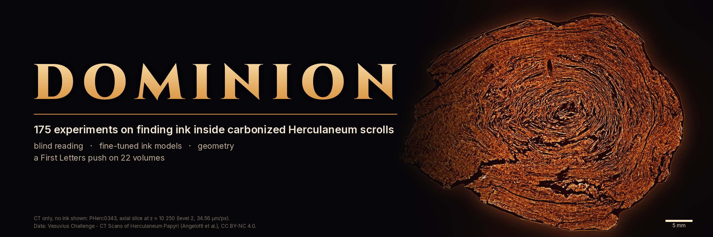
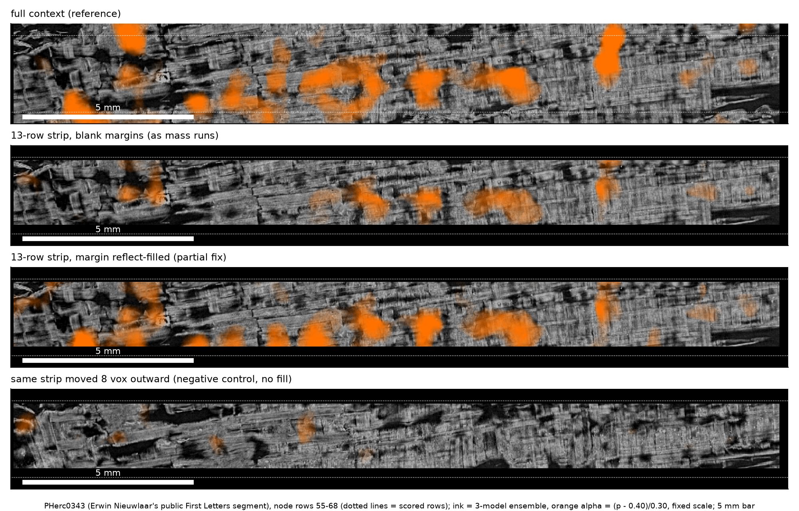

<p align="center"></p>

# Dominion

Dominion is the working record of a batch of experiments on one problem: finding ink inside carbonized Herculaneum
scrolls from public CT. It ran from 24 September to 15 October 2026 as a programme of AI research agents (Claude),
directed by one owner. Each line of attack ran on its own branch: blind reading, fine-tuning ink models, geometry,
and a First Letters push across 22 volumes.

<!-- BEGIN:intro -->
In all, 175 experiments ran on the 116 experiment branches of the project's private working repository, its research log and related repositories (among them the separate PHerc0268 repository); every branch of the 17 project repositories is indexed in [BRANCH_INDEX.md](BRANCH_INDEX.md).
<!-- END:intro -->

The working history stays private, because much of it concerns scrolls that have not been officially read. This
repository is the public release:
- **the experiment map**: what each family of experiments asked, how, and what came of it, failures and nulls included;
- **what survived validation**, released as tools;
- **33 lessons, and the retracted claims of the work behind them** (retractions in other experiments are noted in their
  experiment-map entries).

How the programme worked: decisions were meant to be declared before the data they tested, and metrics run on a known
positive and a known negative first. Where that was not done, the record says so (the 56-strip PHerc0268 mass run was
inked before any positive control, lesson 11 in docs/LESSONS.md; in the experiment map, a Grand Prize model arm whose
known-text gate was dropped, and screens triaged by eye with no declared bar). The numbers of Result 1 come from the
committed scorer outputs (its tables are generated by `scripts/write_tables.py`) and are rounded to the nearest value at
the precision shown; the fill's fold range is truncated. The experiment map copies numbers from its cited sources,
except a few marked as counted or computed at survey. No letters are claimed on any scroll.

## What came out

| # | result | status | where |
|---|---|---|---|
| 1 | **The blank-margin bug in villa ink inference on thin strips**, a partial fix, and a kit to check your own runs (`stripqc`) | measured on a public positive control with a pre-registered test; rerun with fresh inputs; the fix is partial and exploratory | [below](#result-1-blank-render-margins-silently-corrupt-ink-inference-on-thin-strips-stripqc), [docs/RESULTS.md](docs/RESULTS.md) |
| 2 | September 2026 tools: `flatcheck`, `handcheck`, `tifxyz-dist` | released | [flatcheck](https://github.com/abundantjoe/flatcheck), [handcheck](https://github.com/abundantjoe/handcheck), [tifxyz-dist](https://github.com/abundantjoe/tifxyz-dist) |
| 3 | October 2026 tools: `xsec`, `ringstrip`, `orgsec-ink` | released | [xsec](https://github.com/abundantjoe/xsec), [ringstrip](https://github.com/abundantjoe/ringstrip), [orgsec-ink](https://github.com/abundantjoe/orgsec-ink) |
| 4 | 33 lessons, with evidence and fixes | | [docs/LESSONS.md](docs/LESSONS.md) |
| 5 | Retracted claims of the work behind Result 1 and the lessons | | [docs/SUPERSEDED_CLAIMS.md](docs/SUPERSEDED_CLAIMS.md) |

## The experiment map

<!-- BEGIN:experiments -->
| family | period | experiments | outcomes |
|---|---|---:|---|
| [Reading and its calibration](docs/EXPERIMENTS.md#reading-and-its-calibration) | 24 Sep to 30 Sep | 19 | 3 passed · 5 failed · 4 inconclusive · 2 void · 2 stopped · 3 tool |
| [Fine-tuning and own ink models](docs/EXPERIMENTS.md#fine-tuning-and-own-ink-models) | 24 Sep to 10 Oct | 15 | 4 failed · 1 inconclusive · 4 stopped · 6 tool |
| [PHerc. Paris 4 (withheld)](docs/EXPERIMENTS.md#pherc-paris-4-withheld) | - | 72 | 72 withheld |
| [First Letters push](docs/EXPERIMENTS.md#first-letters-push) | 25 Sep to 14 Oct | 23 | 1 passed · 6 failed · 6 null · 1 inconclusive · 1 void · 5 stopped · 3 tool |
| [Geometry: registration, handedness, flattening, umbilicus, unrolling, spiral fits](docs/EXPERIMENTS.md#geometry-registration-handedness-flattening-umbilicus-unrolling-spiral-fits) | 25 Sep to 14 Oct | 27 | 4 passed · 15 failed · 1 null · 3 inconclusive · 1 void · 1 stopped · 1 tool · 1 unknown |
| [Tools, infrastructure and operations](docs/EXPERIMENTS.md#tools-infrastructure-and-operations) | 24 Sep to 10 Oct | 19 | 3 passed · 3 failed · 2 inconclusive · 1 stopped · 10 tool |
| **all families** | | **175** | 11 passed · 33 failed · 7 null · 11 inconclusive · 4 void · 13 stopped · 23 tool · 1 unknown · 72 withheld |

An experiment here is one question with its own verdict, listed once. The 175 come from the research log, the 116 experiment branches and related repositories; 11 of the 103 published here passed. Passed and failed mean the experiment met or missed its stated bars (declared before its data for the pre-registered tests; some checks, such as the training-overlap screen and the data-offload self-test, had an acceptance check but no pre-registration); null means it ran as declared and found nothing; stopped means it was stood down before its verdict step; tool means it built a tool rather than testing a hypothesis. 72 experiments are withheld and only counted: every experiment on PHerc. Paris 4, whatever it showed. The scroll is treated here as not officially read, so its per-experiment results are not published; withholding says nothing about their outcome.
<!-- END:experiments -->

The full map, with every experiment, its verdict, its key numbers and the lesson it taught, is in
[docs/EXPERIMENTS.md](docs/EXPERIMENTS.md).

## Result 1: blank render margins silently corrupt ink inference on thin strips (stripqc)


**Problem.** Ink models in villa (`vesuvius.ink_detection`) run on 128 px patches. They normalise each patch over all
its voxels and use InstanceNorm. `vc_render_tifxyz` renders of thin surface strips (fit-derived strips, ring patches,
tile crops) carry rows of all-zero "blank" CT at their edges, because border mesh nodes have no normal. Every patch that
touches an edge is normalised with those zeros. villa skips patches that are entirely empty, but not partly empty ones.

**What we measured:**
- On a positive control with 13 known letters (PHerc0343, Erwin Nieuwlaar's public First Letters segment), cutting the
  surface into 13-row strips with blank margins, as mass runs do, **roughly halves the real ink** inside the letters. A
  pre-registered test failed it on recall. Filling the margins brings back most of the strong-ink fraction
  (exploratory), which points to the zeros and not only the lost context.
- On an unread scroll (PHerc0268) the blank margins instead **paint false ink bands**: about 2/3 of the strips of a
  56-strip mass run showed them (pre-registration, [SUPERSEDED_CLAIMS](docs/SUPERSEDED_CLAIMS.md) S10). A natural
  experiment inside the strips ties them to the margin, and filling the margin removed them in 5 of the 7 strips
  re-inked with it.

**Partial fix.** Reflect-fill the blank margin for the ink models only (one call, `stripqc.fill`), and keep scoring on the
original render. On the control this brings the strong ink inside the letters and the letter AUC close to their
full-context values. It is not a complete repair: it recovers only part of the full-context strong pixels (recall
below the "fix" bar, which was pre-registered for real padding and is applied to the fill post hoc) and about doubles
the strong pixels outside the letters (table below). Run the positive control in your own geometry before trusting it.

The repository also packages:
- a positive-control-first protocol, with letter-bootstrap CIs and pre-registered decisions;
- a blind-read protocol with hidden positives and hidden negatives in the same format, and a colour baseline that
  shows what such a calibration does and does not prove;
- geometry checks;
- [33 lessons](docs/LESSONS.md) from getting this wrong first.

### Headline results (positive control, displaced negative controls, rerun with fresh inputs)

<!-- BEGIN:headline -->
| PHerc0343 positive control (13 known letters), d = +1 | full context (same pixels) | 13-row strip, blank margins (as usual) | same strip, margin reflect-filled (exploratory) | negative control: moved 8 vox outward (plain / filled, exploratory; conservative, RESULTS §1) |
|---|---|---|---|---|
| strong ink (p > 0.55) inside the letter boxes | 15.38 % | 7.46 % | **14.43 %** | 0.32 % / 1.38 % |
| recall of the full-context strong ink [95 % CI, 13 letters] | 1 | 0.386 [0.257, 0.493] | **0.646 [0.499, 0.768]** | 0.002 / 0.032 |
| box AUC (letter boxes vs the rest, rank-based) | 0.709 | 0.670 | **0.703** | 0.479 / 0.528 |
| strong ink outside the letter boxes | 0.67 % | 0.50 % | 1.35 % | 0.29 % / 0.39 % |
<!-- END:headline -->

On PHerc0268, aggregate only (no images; see [Confidentiality](#confidentiality)):
- ink proxy at fixed render rows: **0.163** where the strip's blank top margin is 30 rows vs **0.049** where it is 10
  rows (higher in 24/29 strips; 400 px strips 0.190 vs 0.029, 6/7);
- the margin fill lowers the strong-ink fraction **2.96-623.9×** on all 7 re-inked strips; the edge bands go away
  in 5 of them.

Every number in the table above is generated from committed JSON by [`scripts/write_tables.py`](scripts/write_tables.py).
See [docs/RESULTS.md](docs/RESULTS.md) for CIs, effective n, the pre-registered vs exploratory split, and the
rerun match.



### Quick start (install and tests: about a minute)

```bash
git clone --depth 1 --single-branch --branch main https://github.com/abundantjoe/dominion-release stripqc && cd stripqc
pip install -e '.[test]'
pytest                                   # 27 synthetic tests with known answers, a few seconds
```

This public repository holds only the release; the working branches stay in a private repository.

Fill a render's blank margin before ink inference. The villa call is the one `scripts/pipeline/batch_ink.sh` makes; it needs a python
with ScrollPrize/villa `vesuvius` and torch (docs/REPRODUCE.md §1). The weights come from
`PYI=/path/to/ink-env/bin/python bash scripts/get_weights.sh ckpt`: about 550 MB for all three models (only
hybrid_3d2d-seed42, 138 MB, is used below; PYI needs torch and safetensors to rebuild dense_native).

```bash
python -m stripqc.fill my_strip/render.zarr my_strip/render_fill.zarr       # valid pixels unchanged; prints fill stats
python -m vesuvius.ink_detection.inference.infer my_strip/render_fill.zarr ckpt/hybrid_3d2d-seed42_step-075000.pth ink.tif \
       --overlap 0.5 --blend-mode hann --batch-size 4 --direction reverse --layer-start 26 --layer-end 43 --no-compile --num-workers 0
```

`--layer-start 26` is depth d = +1 for a 66-layer `vc_render_tifxyz` render: S = 25 + d, the models read layers S to
S + 16, centred on layer 33 + d. On the control, d = +1 puts the centre (layer 34) one layer inside the CT sheet peak
(layer 35). Choose d for your own sheet the same way (docs/METHODS.md §4); only d = +1 was validated here.

Score and display on the ORIGINAL render's valid pixels (CT > 0). Filled pixels are context, never results.

How exposed is a given render? Check its blank margins and which rows inherit blank-containing patches:

```python
import zarr
from stripqc import margins, patchgrid

A = zarr.open('my_strip/render.zarr/0', mode='r')[31:36]   # 5 central CT layers of a 66-layer render
valid = margins.valid_from_render(A)
first, last = margins.column_edges(valid)                    # blank rows above / last valid row, per column
share = patchgrid.blank_share(valid[:, valid.shape[1] // 2]) # middle column: per row, share of blank-containing patches
print('blank top rows:', sorted(set(first.tolist())), '| rows dominated by edge patches:', int((share > 0.5).sum()))
```

### Usage examples

| tool | what it does | example |
|---|---|---|
| `stripqc.fill` | reflect-fill the blank margin of a `vc_render_tifxyz` zarr (valid pixels unchanged) | `python -m stripqc.fill render.zarr render_fill.zarr`, or `reflect_fill(array)` |
| `stripqc.margins` | validity from the CT, blank margins per column, edge distance, band/middle ratio, the top-margin natural experiment | `margins.top_margin_experiment(ink, valid)` |
| `stripqc.patchgrid` | villa's patch positions and the Hann-weighted blank share per row | `patchgrid.positions(260)  # [0, 64, 128, 132]` |
| `stripqc.score` | score strip ink maps against a full-context reference and letter boxes: f_in, f_out, E, recall + letter-bootstrap CI, r, box AUC, coverage, band | `python scripts/control_strips/score_arms.py --bi WORK/bi --erwin pherc343 --out results.json` |
| `stripqc.geometry` | displaced negative control (move a tifxyz d vox along outward normals); extrapolated row padding | `geometry.displace(P, ok, umb, 8.0)` |
| `stripqc.seam` | do two independent fits share a sheet (3-D geometry, not winding index)? map agreement with a circular-shift null | `seam.coincident_fraction(PA, PB, tol=4)` |
| `stripqc.blindread` | blind-read bookkeeping: coded order, per-reader AUC on hidden controls, ROC | `blindread.reader_auc(conf, key, is_pos, is_neg)` |
| `scripts/pipeline/` | the reference render → villa ink → overlay pipeline (`batch_ink.sh`, `RENDER_FILL=reflect`) | [docs/METHODS.md](docs/METHODS.md) |
| `scripts/control_strips/run.sh` | the positive-control experiment at d = +1 (all arms but the original run's exploratory X13) in one command | [docs/REPRODUCE.md](docs/REPRODUCE.md) |

A displaced copy (conservative negative control) of any segment. Choose d as about half your scroll's local sheet
pitch (8 vox on PHerc0343):

```python
from stripqc import tifxyz, geometry

P, ok, meta = tifxyz.load('segment.tifxyz')
Q, okq, outward = geometry.displace(P, ok, tifxyz.load_umbilicus('umbilicus.json'), d=8.0)
tifxyz.save('segment_plus8.tifxyz', Q, okq, meta)   # render and ink it: real ink should fall to near the floor
# nodes next to invalid nodes get no normal and are dropped; with the fill a weak letter-located residue remains (RESULTS §1)
```

### Figures

| figure | content | data |
|---|---|---|
| [fig. 1](figures/fig1_mechanism.png) | mechanism: villa patch grid on a 260 px strip; predicted blank share vs the observed band profile | PHerc0268 aggregate profile |
| [fig. 2](figures/fig2_natural_experiment.png) | natural experiment: 30-row vs 10-row blank top margin, same rows, same strip | PHerc0268 aggregates |
| [fig. 3](figures/fig3_control_before_after_fill.png) | positive control before/after the fill, with the displaced negative control | PHerc0343 letters already published by their discoverer |
| [fig. 4](figures/fig4_recall_by_strip_geometry.png) | recall by strip geometry with 95 % CIs | PHerc0343 |
| [fig. 5](figures/fig5_blindread_roc.png) | blind read #2 ROC (hidden positives vs hidden negatives), with the colour-only baseline | PHerc0343 controls |
| [banner](figures/dominion_banner.png) | axial CT slice of PHerc0343 in ember tones, 5 mm bar (CT only, no ink shown); `scripts/make_banner.py` | PHerc0343 CT, public |

### Limitations

- One positive control: PHerc0343, one segment, 13 letters in scope, d = +1, three 9 µm models. Effect sizes are
  specific to this setting.
- The sign difference between scrolls (suppression on PHerc0343, false ink on PHerc0268) is not explained.
- The fill about doubles the strong pixels outside the letters (1.35 % vs 0.67 % for full context); the excess is in
  both the 20-80 px edge band and the strip middle (RESULTS §1).
- The +8 vox displaced copy is a conservative negative, not an ink-free input: the models' 17-layer window still
  reaches the original sheet. With the fill it shows a weak letter-located signal (`FD8`; RESULTS §1).
- Which step turns the zeros into the artifact (per-patch normalisation, InstanceNorm, or the convolutions seeing
  zeros) has not been isolated; the code path is verified, the attribution is not.
- Blind readers were AI agents. The strong-pixel fraction alone separates the hidden controls better than any reader
  (AUC 0.975 vs 0.875-0.900), so read #2 shows calibration to colour, not letter recognition.
- The PHerc0268 evidence is aggregate only. Its images are not public, so those numbers cannot be recomputed from
  this repository.
- The rerun reused the documented software stack (not reinstalled, renderer not rebuilt) and a local copy of the
  segment repository at `e8370f1` (checksums verified); the CT and the weights were downloaded fresh. It shows the
  result is deterministic with fresh inputs, not an independent reproduction.
- Verified at villa `41701aa`. The ink-inference code is unchanged on villa `main` at `5432721` (14 Oct 2026), but the
  renderer has changed since, and its blank margin has not been rechecked there.

## Lessons learned (33)

The full list, with the fix for each and an evidence pointer for lessons 1-21 (many of them private records; lesson 8's
evidence did not survive, which is its point; 22-33 are operational), is in [docs/LESSONS.md](docs/LESSONS.md). Retracted claims are in
[docs/SUPERSEDED_CLAIMS.md](docs/SUPERSEDED_CLAIMS.md). The ones most likely to save you days:
1. **Put a known positive through the identical geometry before any mass run.** We inked 56 strips before learning
   that the strip geometry hides real ink and paints fake ink.
2. **Validity comes from the CT, never from p > 0.** Ink maps are about 0.31 over blank margins.
3. **Fixed-scale displays and fixed thresholds hide attenuated ink.** Check rank metrics (AUC) as well.
4. **Winding indices of independent fits are not comparable** (3-15 sheets apart). Match surfaces by 3-D geometry.
5. **Seam agreement is not ink.** Both maps read the same CT. Require face specificity and a dark ±8 vox displaced copy.
6. **A blind read without hidden positives and negatives in the same format is uninformative.** Ours missed both
   hidden positives the first time. With them, check that colour alone does not explain the readers' AUC: ours did not
   pass that check.
7. **Calibrate every metric on a known positive and a known negative.** Use circular-shift nulls with equal n.
8. **Trace each artifact's code path before mapping pixels.** One wrong flip turned r = +0.43 into −0.20 for us.
9. **Never round a claim beyond its data** (we once wrote 3-700× for 2.96-623.9×, S11), **and say exactly which data a
   pre-registration precedes.**

## Confidentiality

- PHerc0268 is an unread scroll. This release contains **no PHerc0268 ink image**, no PHerc0268-specific blind-read outcome (whatever it
  showed) and no result tied to a named strip or location; only aggregate artifact statistics, anonymised per-strip value pairs, and the experiment-level results
  (verdicts and aggregate numbers) in the experiment map.
- PHerc. Paris 4 is also treated as unread: every experiment on it is withheld, whatever it showed, and only counted.
  Apart from PHerc0343, no image or map of any scroll is included.
- The PHerc0343 letters shown are a positive control, already published by their discoverer (Erwin Nieuwlaar,
  `github.com/Nieuwlaar/pherc343-first-letters`, outputs/concat_w047-w048_R5B2_z9500-11000.png).
- [BRANCH_INDEX.md](BRANCH_INDEX.md) lists every branch of the project's repositories. For private repositories it omits
  commit messages and changed directories, and names only the default branches, the research-log branches and branches that a published experiment cites.

## Repository layout

```
stripqc/                  the package (fill, margins, patchgrid, score, geometry, seam, blindread, tifxyz)
tests/                    synthetic unit tests with known answers
scripts/pipeline/         reference render + villa ink pipeline (batch_ink.sh, RENDER_FILL=reflect)
scripts/control_strips/   positive-control experiment: arms, runner, scorer, box-shift check, ink runtime
scripts/                  reproduce.sh, get_weights.sh, rebuild_dense_native.py, make_figures.py, write_tables.py,
                          natural_experiment.py, blindread_colour_baseline.py, branch_inventory.py,
                          branch_inventory_git.py, branch_index.py,
                          make_banner.py, make_branch_banner.py (banners: CT only, no ink shown)
results/                  committed results (control: original + reproduction; PHerc0268 aggregates; blind reads;
                          experiments/experiment_map.json, the experiment map)
figures/                  fig. 1-5, the Dominion banner
docs/                     EXPERIMENTS, METHODS, RESULTS, LESSONS, REPRODUCE, SUPERSEDED_CLAIMS, prereg/
BRANCH_INDEX.md           every branch of every project repository, with status
SUBMISSION.md             Progress Prize form text
```

## License and citation

- Code: MIT ([LICENSE](LICENSE)).
- Scroll data and derived images and numbers: CC BY-NC 4.0, with the dataset citation (Angelotti et al.); see
  [DATA_LICENSE.md](DATA_LICENSE.md).
- Cite this work via [CITATION.cff](CITATION.cff).

Built on ScrollPrize/villa (`vesuvius`, volume-cartographer), the `ink_9um` models, and Erwin Nieuwlaar's PHerc0343
segment and `dense_native` model. Run by AI research agents (Claude) directed by one owner. The d = +1 positive-control numbers
(all arms but X13) are reproduced by the scripts in this repository; the X13, d = -2 and strip-middle values come from
the committed original run (`results/control_strips/original_results.json`); the other numbers come from the private
working record (the PHerc0268 aggregates, blind-read scores and experiment map are committed as JSON).

---
*Part of **Dominion**, directed by Joseph Balmaceda and run by Claude research agents (Sept-Oct 2026). Every lesson from every branch, in one file: [MASTER_LESSONS.md](https://github.com/abundantjoe/scroll-lessons/blob/main/MASTER_LESSONS.md). This branch is a scrubbed snapshot of the private archive: personal data removed, files over the size policy listed in `DATA_MANIFEST.tsv`, prize-candidate details withheld.*
