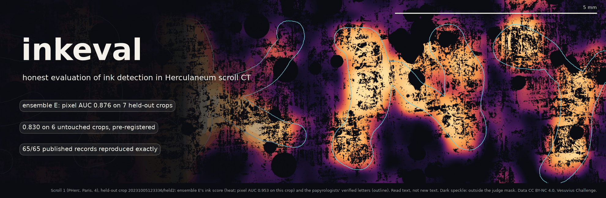
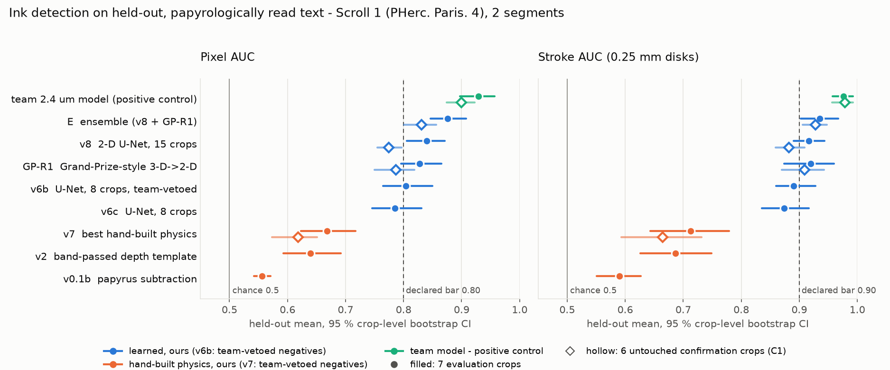
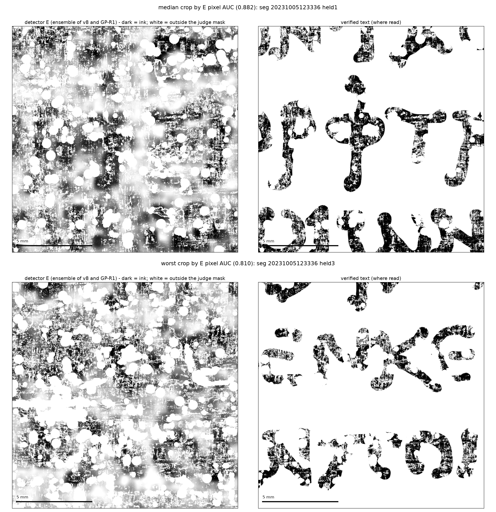
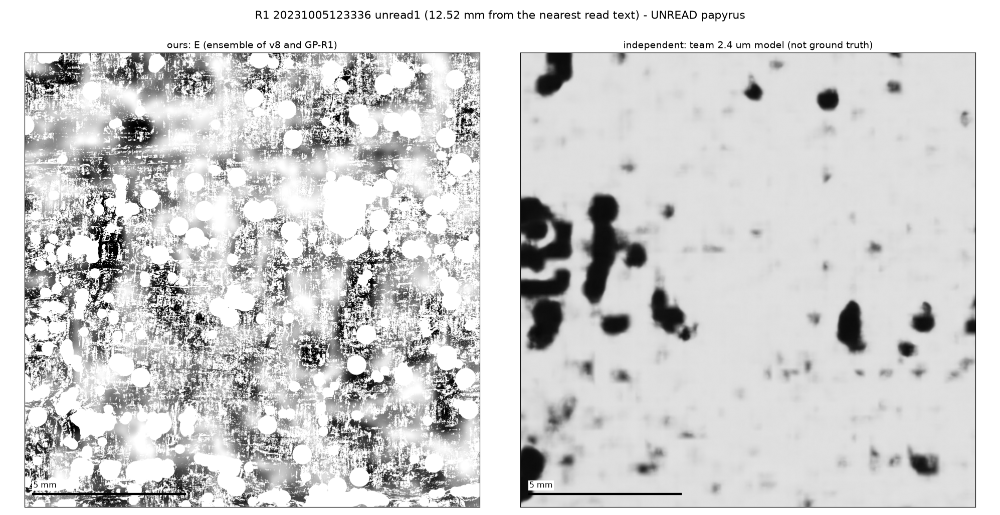
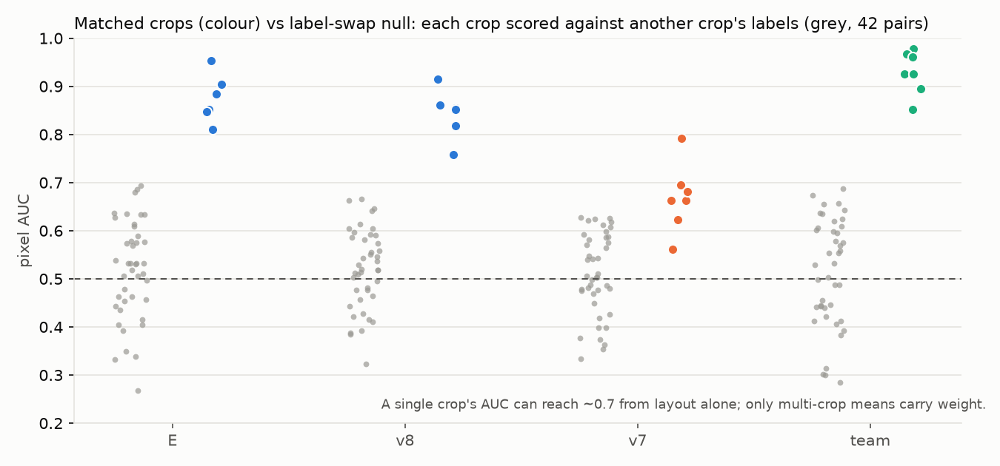
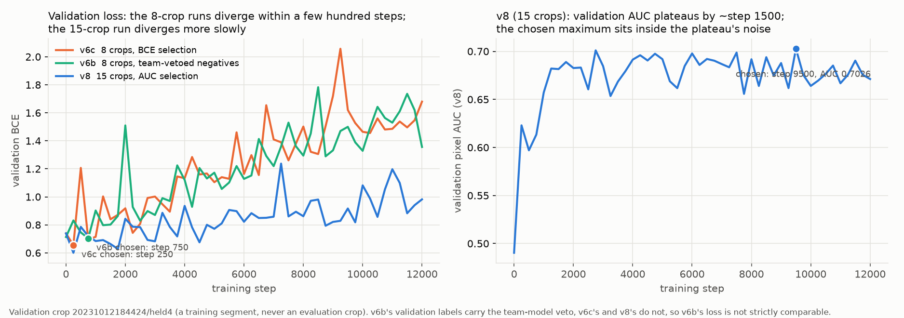

# inkeval — honest evaluation of ink detection in Herculaneum scroll CT

**A small, tested toolkit for judging ink-detection maps against hand-labelled text, and the pre-registered study on Scroll 1
(PHerc. Paris. 4) that produced it — including a confirmation test on crops this study had not touched.**

Ink detectors for the Herculaneum scrolls are compared by AUC against hand-labelled text, usually on a few crops. While building
detectors for the 2.4 µm Scroll 1 CT under strict pre-registration, we found four problems in **the evaluation
itself**: a letter-level test that was undefined on some crops and swung with the mask; a team-model "veto" that silently deleted every
negative from 7 of the 8 training crops; single-crop AUCs that reach 0.69 from spatial layout alone; and an evaluation set reused across
a whole sequence of methods. `inkeval` packages the fixes — a stroke-level test defined wherever strokes thicker than 0.5 mm and blank
papyrus each yield at least 20 disks, a local test that separates letters from regional brightness, crop-level bootstrap intervals, a label-swap negative control, rank ensembling and
community-format export — and reproduces the study's published judge records **exactly** (65 of 65 records: E, v8, GP-R1, v7 and the team model on all 7 evaluation and 6 confirmation crops, pixel AUC to the identical float, stroke and L to the 4 decimals stored; `scripts/check_toolkit_records.py`, [`results/toolkit_vs_records.json`](results/toolkit_vs_records.json)). The study's best detector,
an ensemble E of a 2-D U-Net and a Grand-Prize-style 3-D→2-D network trained only on hand labels, reaches pixel AUC **0.876** and stroke
AUC **0.935** on 7 held-out crops, against 0.668 for the best hand-built physics. On 6 crops this study had not touched before the confirmation
test was declared, it reaches **0.830 [0.800, 0.856]** and **0.928 [0.905, 0.947]**: the pre-registered prediction held, with less margin,
and a single U-Net that passed on the evaluation crops did not pass there. It does **not** yet read unread papyrus — we measured how far
detection gets there, and state what we think limits it (INFERENCE).



## Headline results

Every method in this table was declared in [`docs/RULES.md`](docs/RULES.md) before its first result was recorded. v7, v8 and E were
judged once per crop set; v0.1b and the team model were first judged under the original mask and letter test, and their evaluation values
shown here come from re-judging under mask J and the stroke test, which were declared later and applied to every method alike.
`scripts/check_preregistration.py` checks the declaration-before-result order in git; the three exceptions (the stroke test and the local
test L, each declared and first run in one commit, and R2, whose maps were computed before its declaration) are listed in
[RESULTS §1](docs/RESULTS.md#1-pre-registered-tests-and-their-order). Means over crops with 95 % crop-level bootstrap intervals
(10 000 resamples, seed 0). Values are truncated, never rounded up. Effective n = crops (2 segments), never pixels.

| | **evaluation**, 7 crops: pixel AUC | stroke AUC | **confirmation C1**, 6 untouched crops: pixel AUC | stroke AUC |
|---|---|---|---|---|
| **Before** — best hand-built physics (v7) | 0.668 [0.622, 0.717] | 0.712 [0.643, 0.779] | 0.618 [0.573, 0.650] | 0.664 [0.593, 0.731] |
| Papyrus subtraction, the original route (v0.1b) | 0.556 [0.542, 0.570] | 0.590 [0.550, 0.626] | — | — |
| v8 alone (2-D U-Net) | 0.839 [0.805, 0.871] | 0.916 [0.890, 0.943] | 0.774 [0.754, 0.796] | 0.881 [0.859, 0.908] |
| **After** — ensemble E (no team-model veto or scores in training; labels placed against the team model, see [Limitations](#limitations)) | **0.876 [0.846, 0.907]** | **0.935 [0.902, 0.967]** | **0.830 [0.800, 0.856]** | **0.928 [0.905, 0.947]** |
| Positive control — the team's 2.4 µm model | 0.929 [0.896, 0.956] | 0.975 [0.957, 0.992] | 0.899 [0.873, 0.922] | 0.978 [0.956, 0.992] |
| Negative control — label-swap null, E (mean, range) | 0.517, 0.267–0.694 (42 pairs) | — | 0.546, 0.361–0.654 (30 pairs) | — |
| Declared bars | 0.80 | 0.90 | 0.80 | 0.90 |

- **E vs best hand-built physics:** +0.207 [0.171, 0.257] pixel and +0.222 [0.163, 0.296] stroke on the evaluation crops (7/7 crops);
  +0.212 [0.188, 0.234] and +0.264 [0.203, 0.320] on C1 (6/6).
- **The confirmation test C1 held** ([RESULTS §5](docs/RESULTS.md#5-confirmation-test-c1--6-untouched-crops-pre-registered)): E's C1 means
  clear both bars, also at the lower ends of their intervals (0.800, 0.905), and E beats v7 on all 6 crops — the prediction written down
  before any window was chosen. E lost 0.0456 pixel AUC relative to the evaluation crops (two-sample CI −0.0885 to −0.0055; interval method chosen post-hoc); the
  positive control lost 0.0297 on the same crops (post-hoc: written after 4 of the 6 C1 pixel values had been read and committed after 5 crops had been judged; CI −0.0674 to
  0.0087), so most of the drop looks like harder windows rather than overfitting to the evaluation set (INFERENCE). **v8 alone did not replicate its evaluation-set pass** (0.774 / 0.881 on C1): only the pre-declared ensemble did.
- The positive control was used to place the reference labels (see [Limitations](#limitations)), so its score is partly self-referential.

Full tables, per-crop values, paired comparisons, nulls, pre-registered vs exploratory: [`docs/RESULTS.md`](docs/RESULTS.md).

## What we measured (and what it means for anyone building detectors)

1. **Papyrus subtraction is near chance at 2.4 µm, and the best hand-built physics stays below the bars.** Papyrus subtraction reaches
   0.556 pixel AUC on read text (7 crops); sheet thickness alone 0.478 (one crop, the segment-1 TRAIN crop). The best hand-built
   depth-profile ridge (v7, on the 19.2 µm pooled stack) reaches 0.668.
2. **Learned detectors trained only on hand labels clear the bars — as an ensemble.** The 2-D U-Net v8 (270 817 parameters, CPU)
   reaches 0.839 [0.805, 0.871] / 0.916 [0.890, 0.943] on the evaluation crops — a pass on the mean, with its stroke interval spanning
   the bar — but 0.774 / 0.881 on the untouched C1 crops. The pre-declared ensemble E passes on both sets.
3. **At 19.2 µm input, the Grand-Prize-style 3-D→2-D architecture made no measurable difference in pixel or stroke AUC.** GP-R1 vs v8: −0.011 pixel
   [−0.042, 0.014] as published; with equal post-processing GP-R1 is ahead by +0.009 [−0.019, 0.033]; on C1 GP-R1 − v8 = +0.012
   [−0.010, 0.025] pixel (5 of 6 crops, published post-processing). A tie in pixel and stroke AUC on each set, with a CPU-scaled version of the
   architecture; on C1 the diagnostic L favours GP-R1 (v8 − GP-R1 = −0.030 [−0.056, −0.003], 1 of 6 crops, published post-processing).
4. **Ensembling two tied, separately trained models (same training data, different architectures) helps.** E − v8 = +0.036
   [0.020, 0.051] pixel (6 of 7 crops); on C1 +0.055 [0.037, 0.069] (6 of 6). A post-hoc
   decomposition (D3) attributes +0.024 to +0.028 to ensembling and +0.008 to +0.012 to the 0.08 mm smoothing; the +0.018 stroke difference
   (CI −0.003 to 0.037, not distinguishable from zero) is almost entirely ensembling (unsmoothed rank mean − v8 = +0.018; smoothing
   alone slightly lowers stroke AUC).
5. **Using the team model to choose negatives is worth +0.018 [0.008, 0.028]** pixel (v6b − v6c, 7 of 7 crops) — measured with a
   no-teacher control, not assumed harmless.
6. **More crops and AUC-based checkpointing went together (+0.054 [0.027, 0.084], v8 − v6c, 7/7 crops)** — two changes at once, so we do
   not attribute the gain to data alone.
7. **Detection is not legibility.** On unread papyrus our ensemble agrees with the team model's confident ink calls at AUC 0.793–0.886 per
   window — every window above its swapped-window null (max 0.652) — yet no legible character appears in any render.

## Quick start (5 minutes)

```bash
git clone https://github.com/abundantjoe/megara && cd megara
python3 -m venv .venv && . .venv/bin/activate
pip install -e ".[test]"          # numpy, scipy, pillow (+ pytest)
inkeval demo                      # ~2.5 s: judges E, v7 and the team model on two bundled held-out Scroll 1 crops, with a negative control
pytest -q                         # ~10 s (9.1–10.1 s measured): 15 pass, 3 skipped (those 3 need the research data and reproduce published numbers exactly)
```

The demo prints (VERIFIED on the release machine; bundled crops are pooled 8× to 19.2 µm, so values differ from the 2.4 µm results):

```
inkeval demo - two held-out Scroll 1 crops pooled to 19.2 um (bundled; CC BY-NC 4.0 data)

crop                         method   pixel  stroke  local L
20231005123336_held2         e        0.929   0.988    0.997
20231005123336_held2         v7       0.800   0.878    0.913
20231005123336_held2         team     0.954   0.996    0.995
20231210121321_held1         e        0.875   0.973    0.966
20231210121321_held1         v7       0.571   0.562    0.735
20231210121321_held1         team     0.943   0.997    1.000

negative control - label swap between the two crops (should sit near 0.5):
  e     mean 0.502 over 2 ordered pairs
  v7    mean 0.462 over 2 ordered pairs
  team  mean 0.473 over 2 ordered pairs

Note: a single crop is not a sample size. Put intervals on crops, e.g.
  inkeval bootstrap results/per_crop_evaluation7.csv --column e_pixel
```

## Using the tools

**Judge one prediction against a label** (any 2-D maps of the same shape: `.npy`, `.npz:key`, `.png`, `.tif`; label and mask are read
as `> 0`). `--pitch-um` must be the maps' pixel pitch in µm (default 2.4): it converts every distance in mm (the 0.3 mm blank gap, the 5 mm
zone, the 0.25 mm disks, the 1.5 mm local radius) to pixels. A wrong value cannot be detected from the maps; when it empties a class
(on the bundled 19.2 µm crops, `--pitch-um 2.4` leaves no blank pixels and all three AUCs print `null`), `judge` prints a warning to
stderr naming the empty class.

```bash
inkeval judge --score pred.npy --label label.npy --mask mask.npy --pitch-um 2.4
```
Output for E on evaluation crop 20231005123336/held1, condensed (the CLI prints one key per line and adds the input path as `"score"`).
Pixel AUC is the identical float in the published records (`results/per_crop_evaluation7.csv`); stroke AUC and local L equal the
4-decimal records in `stats/stroke_test.json` and `stats/local_stroke_test.json`, with identical disk counts
([`results/toolkit_vs_records.json`](results/toolkit_vs_records.json)):
```json
{"pixel_auc": 0.8828924602993242, "stroke_auc": 0.9393775777052081, "local_L": 0.929321519960213,
 "text_px": 6141768, "blank_px": 10094980, "stroke_disks": {"ink": 202, "blank": 761},
 "local_pairs": {"ink": 202, "blank": 761, "paired": 165}, "score": "pred.npy"}
```
Read the three numbers together: *pixel* is the usual AUC; *stroke* asks whether the detector is right when integrated over a disk of
radius 0.25 mm (defined even when hand labels merge whole words into one component); *local L* compares each stroke only with blank
papyrus within 1.5 mm, so a detector that merely tracks regional brightness scores ≈ 0.5 on L however high its pixel AUC.

**Put an interval on a set of crops** (the crop, not the pixel, is the unit of replication):

```bash
inkeval bootstrap results/per_crop_evaluation7.csv --column e_pixel     # mean 0.876, 95 % CI [0.846, 0.907], n = 7
```

**Run the negative control** — score each crop against the *other* crops' labels; a reader of letters sits near 0.5. All crops must
have the same shape and pixel pitch (give `--pitch-um` if it is not 2.4); `pairs` in the output counts the ordered pairs that had both
text and blank pixels:

```bash
inkeval null --scores a.npy b.npy c.npy --labels la.png lb.png lc.png --masks ma.png mb.png mc.png
```

**Ensemble differently calibrated detectors** (rank-normalise inside the mask, average, smooth):

```bash
inkeval ensemble --scores v8.npy gpr1.npy --mask mask.npy --sigma-mm 0.08 -o e.npy
```

**Export a prediction for the community** (8-bit PNG, ink bright, 0 = not judged, plus a JSON sidecar with segment and canvas origin):

```bash
inkeval export --score e.npy --mask mask.npy -o pred.png --segment 20231005123336 --y0 12400 --x0 23560 --method "E"
```

**From Python:**

```python
from inkeval import judge, judge_classes, stroke_auc, local_stroke_auc, bootstrap_ci, paired_bootstrap, label_swap_null, rank_mean
r = judge(score, label, mask, pitch_um=2.4)                       # dict with pixel_auc, stroke_auc, local_L
ci = paired_bootstrap(auc_method_a_per_crop, auc_method_b_per_crop)  # mean difference, CI, crops favouring a
```

**Reproduce the study** — from 2.5 seconds to a full rebuild from public data, each level with its commands and verification status,
and for Levels 0–4 its expected output (checksums where outputs are deterministic; Level 5, retraining, was not re-run): [`docs/REPRODUCE.md`](docs/REPRODUCE.md).
The released weights regenerate the v8, GP-R1 and E maps behind the published numbers (the maps are not versioned; their SHA-256 are)
**bit for bit on all 7 evaluation crops**, and E's pixel AUC equals the published value on each (`scripts/check_reproducibility.py`,
[`results/reproducibility_check.json`](results/reproducibility_check.json); VERIFIED on the release machine, NOT VERIFIED on other CPUs).

## Figures

| | |
|---|---|
|  | **E's output on held-out read text**, median crop (top) and worst crop (bottom) by pixel AUC, beside the verified label. All 13 evaluation and confirmation crops: [`figS_all_crops.png`](docs/figures/figS_all_crops.png). |
|  | **Unread papyrus, 12.5 mm from the nearest read text**: E (left) and the team model (right). E agrees with the team's ink calls above the swapped-window null, yet renders no legible character. |
|  | **Negative control**: matched crops (colour) vs every crop scored against another crop's labels (grey). Single crops reach ~0.69 from layout alone. |
|  | **Training**: with 8 crops validation loss diverges within a few hundred steps; with 15 it diverges more slowly and validation AUC plateaus by ~1 500 steps. |

## Lessons learned

The record supports **84 distinct lessons**, each with its evidence (file, commit, number) and its fix or "open":
[`docs/LESSONS.md`](docs/LESSONS.md). The ones that would change another team's conclusions:

- **Assert that both classes exist before training** ([31](docs/LESSONS.md#lesson-31)). A declared veto on the team's JPEG overview
  (keep a negative only where the overview is below 0.10) admitted no pixel on the training crops checked (fraction 0.000), so it deleted
  every negative on 7 training crops; the run's falling validation loss meant nothing.
- **Do not put a bar on component-based letter tests over hand labels that merge words** ([4](docs/LESSONS.md#lesson-4)). Undefined on
  2 of 7 crops under the final mask (4 of 7 under the original one) and swinging with the mask where defined; the stroke test replaces it.
- **Measure a null instead of assuming 0.5** ([22](docs/LESSONS.md#lesson-22)). Single crops reach 0.694 under label swap.
- **Report crops, not pixels, as n — and confirm on untouched data** ([21](docs/LESSONS.md#lesson-21), [13](docs/LESSONS.md#lesson-13)).
  The evaluation set was reused across 13 methods (v0.1b, v0.3p, v1a, v1b, v2, v3, v5, v6b, v6c, v7, v8, GP-R1, E) and the E1 explorations;
  on untouched crops E lost 0.0456 pixel AUC and the positive control 0.0297 (post-hoc).
- **Change one thing at a time, or do not attribute** ([23](docs/LESSONS.md#lesson-23)). v8 changed data and checkpoint criterion together.
- **Separate ensembling from smoothing before crediting ensembling, and post-process compared methods alike**
  ([24](docs/LESSONS.md#lesson-24)).
- **Do not let the comparator place the reference it is scored on; register per crop with a positive control on every crop**
  ([2](docs/LESSONS.md#lesson-2), [1](docs/LESSONS.md#lesson-1)). A label shift of about 1 mm on one crop (1.024 mm in the check that found it, 7375777; 1.033 mm as applied,
  [METHODS §2](docs/METHODS.md)) surfaced only when the team model fell to 0.615 there.
- **Reproduce the known-good recipe before inventing methods** ([60](docs/LESSONS.md#lesson-60)) — we did so late, and one 2.3-hour CPU
  run showed no measurable architecture effect on pixel or stroke AUC at 19.2 µm.
- **Detection is not legibility; a reading run needs a blank control chosen by evidence of absence, not distance**
  ([17](docs/LESSONS.md#lesson-17), [9](docs/LESSONS.md#lesson-9)).
- **Never round up, and generate every table from versioned per-crop files** ([68](docs/LESSONS.md#lesson-68)).

All **76 superseded claims** (retracted, corrected, invalidated, redefined or narrowed), and why: [`docs/SUPERSEDED_CLAIMS.md`](docs/SUPERSEDED_CLAIMS.md).

## Limitations

- **Small n.** 7 evaluation and 6 confirmation crops from 2 segments of 1 scroll. Intervals are crop-level; segment-level generalisation is
  not established.
- **Reference placement uses the positive control.** Labels, training and evaluation alike, are aligned to the team model's prediction (global fit, then ±1.5 mm per crop),
  so the team model's score is partly self-referential and the labels inherit any error in that prediction's geometry.
- **The labels were drawn on an earlier model's output** and then read by papyrologists; they are the best available truth, not
  profilometry. We do not know the team model's training labels; if they include this label family, its score is further inflated
  (INFERENCE).
- **Training-label quality.** Three training crops sit at the registration search limit and one within 8 px of it (labels possibly
  misplaced by > 1.5 mm); the v7
  baseline was fitted on team-vetoed negatives, so it is not free of team-model input.
- **CPU scale.** All our models are small (≤ 0.5 M parameters) and see 19.2 µm pooled input; GP-R1 is a scaled-down reproduction of the
  Grand-Prize architecture, so "no architecture effect" holds only at this scale. GP-R2 at 9.6 µm was declared and not run.
- **No new text.** No character has been recovered from unread papyrus.
- **Single machine.** Bit-identical regeneration is verified on the release machine only.

## Repository layout

```
inkeval/            the toolkit (metrics, stats, ensemble, export, CLI, bundled example)
tests/              18 tests, incl. exact reproduction of published judge records
scripts/            the research pipeline (index: scripts/README.md; superseded scripts are in archive/scripts/)
models/             released weights v8, GP-R1, v6b, v6c (+ training curves, SHA256SUMS)
results/            release statistics, decompositions, nulls, input manifest, reproducibility check, run logs
stats/              raw research records: crop coordinates, registrations, judge summaries, stroke-test records
docs/               METHODS, RESULTS, LESSONS, REPRODUCE, SUPERSEDED_CLAIMS, the lab notebook RULES.md, figures
archive/            superseded documents and scripts (moved with history)
```

## License and citation

Code: MIT ([`LICENSE`](LICENSE)). Data and everything derived from it (bundled example, figures showing papyrus, weights, measurements):
Vesuvius Challenge data under **CC BY-NC 4.0** — see [`DATA_NOTICE.md`](DATA_NOTICE.md) for the sources and the required citations,
including the EduceLab-Scrolls citation for the Grand-Prize labels. Cite this work via [`CITATION.cff`](CITATION.cff).

This release was built with the help of an AI assistant (Claude, Anthropic); every result number in it is copied from a committed file and
was checked against it; timings are measurements on the release machine.

---
*Part of **Dominion**, directed by Joseph Balmaceda and run by Claude research agents (Sept-Oct 2026). Every lesson from every branch, in one file: [MASTER_LESSONS.md](https://github.com/abundantjoe/scroll-lessons/blob/main/MASTER_LESSONS.md). This branch is a scrubbed snapshot of the private archive: personal data removed, files over the size policy listed in `DATA_MANIFEST.tsv`, prize-candidate details withheld.*
