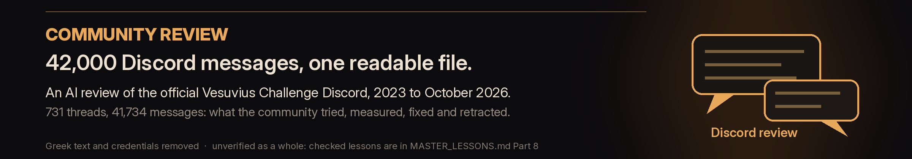

# Scroll Lessons

**Download [`MASTER_LESSONS.md`](MASTER_LESSONS.md) ([raw](https://raw.githubusercontent.com/abundantjoe/scroll-lessons/main/MASTER_LESSONS.md)) and give it to your AI system as context. That is the whole point of this repository.**

Dominion was a two-month, AI-run research programme (September-October 2026) on the Vesuvius Challenge: finding ink inside
carbonized Herculaneum scrolls. It ran 387 experiments on 118 branches plus two earlier programmes (Hercules and Megara), across PHerc0268, PHerc. Paris 4 and
the 22 volumes of a First Letters push. We did not build a pipeline that reads every scroll. What we built is the record of what
works, what fails and why, with the evidence for each answer.

`MASTER_LESSONS.md` puts all of it in one file: 656 lessons (each a trap, its evidence and its fix), the verdict of every
experiment, every claim we had to retract, a start-to-finish timeline, and where to pick up. Paste it into Claude or any other
model before you start, and your session begins where we stopped instead of rediscovering our dead ends.

## Why this is a progress driver

- **Dead ends are the expensive part.** Most of our compute went into ideas that failed for reasons that are easy to state once
  known: render margins that fake ink, ink models that respond to sheet contrast, blind readers that track colour, winding indices
  that do not compare across fits. Each is now a few lines in one file.
- **It is written for machines as much as people.** Every lesson has the same shape (trap, evidence, fix, label, sources), numbers
  are kept, and the golden rules at the top are imperative. A model can follow it without reading 118 branches.
- **Nothing is hidden behind the summary.** Every experiment still has its own branch here, scrubbed, with its records, code and
  a quick-start for verifiers ([experiments index](experiments/README.md)).
- **Honest about failure.** Each lesson carries a label (VERIFIED, MEASURED, INFERENCE or RETRACTED), and the retracted claims
  are listed with what was wrong.

## What is in this repository

| Where | What |
|---|---|
| [`MASTER_LESSONS.md`](MASTER_LESSONS.md) | every lesson, verdict, retracted claim and open problem, with a table of contents |
| [`worlds-first/`](worlds-first/README.md) | 3,971 never-before-published ink-model images of scroll areas that have never been read |
| [`community/`](community/COMMUNITY_DIGEST.md) | readable digest of ~42k Vesuvius Discord messages, plus the full redacted AI review (unverified as a whole) |
| [`experiments/`](experiments/README.md) | one page per experiment branch: question, verdict, lesson, link to its branch and quick-start |
| branch `dominion-release` | the October 2026 Progress Prize release: the stripqc finding (blank render margins corrupt villa ink inference on thin strips), its code, tests and one-command reproduction |
| branch `research-log` | the hash-chained decision log of the whole programme |
| 118 experiment branches | each experiment's code, records and results, scrubbed |

## The ink images: a first look at never-read areas

[`worlds-first/`](worlds-first/README.md) holds the ink-model renders we made of scroll areas with no published reading: PHerc0268,
the unread areas of PHerc. Paris 4, and the volumes of the First Letters push. None of these renders has been published before.
They are model outputs, not readings: our own lessons show that much of what looks like ink on thin
strips is a rendering artifact, and **no letters are claimed**. A small number of patches under prize review are withheld.

## Community review: 42,000 Discord messages in one file

**Start with [`community/COMMUNITY_DIGEST.md`](community/COMMUNITY_DIGEST.md)**: a readable digest (about 12,000 words) of
what the community learned: state of play, timeline, topic-by-topic findings, current rules, top traps, retracted claims and
rules for AI agents, each finding linked to its checked lesson.

The full archive, [`community/VESUVIUS_COMMUNITY_PROGRESS_AND_NOTES.md`](community/VESUVIUS_COMMUNITY_PROGRESS_AND_NOTES.md) is a large (2.8 MB) AI-written review of
the official Vesuvius Challenge Discord: 731 threads and 41,734 messages, February 2023 to 20 October 2026. It covers what the
community tried, measured, fixed and retracted, by year and by topic, with a dossier per thread. Use it to find where a topic was
discussed, then read the original thread.

- **Unverified as a whole.** The lessons drawn from it were checked against the raw messages and are in
  [`MASTER_LESSONS.md`](MASTER_LESSONS.md) Part 8 (L657-L794); its known errors, such as claims later retracted, are listed in section 8J.
- **Redacted.** Greek text, including transcriptions of scroll text, is replaced by `[Greek]` because the data terms keep scroll
  text inside the official Discord. A shared download login and a link token were removed.

## Credits and citation

Dominion was directed by **Joseph Balmaceda** and run by Claude research agents (Anthropic). Cite this repository with
[`CITATION.cff`](CITATION.cff). Scroll data: Vesuvius Challenge - CT Scans of Herculaneum Papyri (Angelotti et al., CC BY-NC 4.0).
Data used in the preparation of the PHerc. Paris 4 material were obtained from the EduceLab-Scrolls dataset (Parsons, Parker,
Chapman, Hayashida and Seales, 2023, [doi:10.48550/arXiv.2304.02084](https://doi.org/10.48550/arXiv.2304.02084)). Built on
[ScrollPrize/villa](https://github.com/ScrollPrize/villa), the organizers' `ink_9um` models, and Erwin Nieuwlaar's PHerc0343
segment and `dense_native` model.

Code is MIT ([`LICENSE`](LICENSE)); lessons, images, results and records are CC BY-NC 4.0 ([`DATA_LICENSE.md`](DATA_LICENSE.md)),
because they derive from Vesuvius Challenge data.
