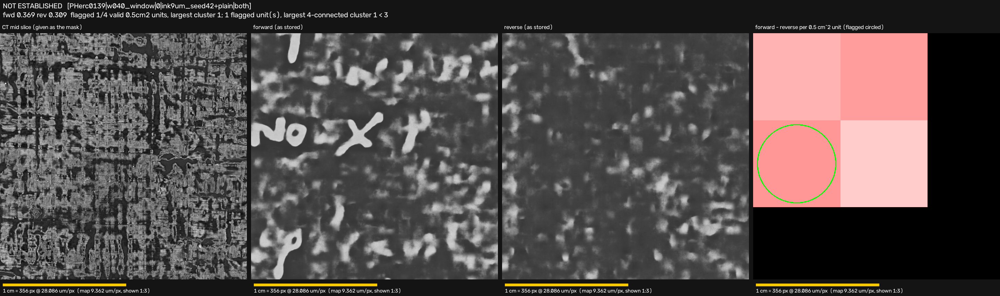
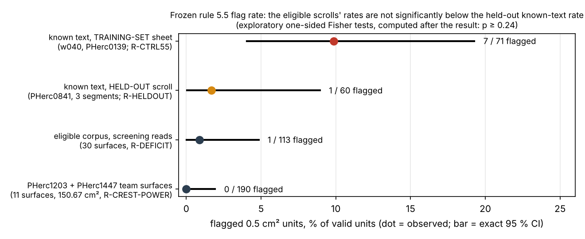
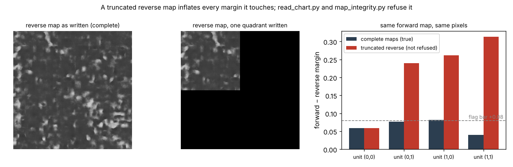
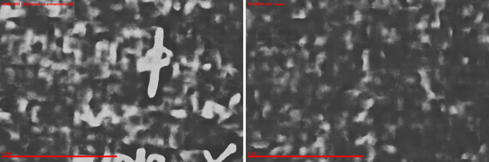

# hercules — ink reads checked against matched negative controls

**Quality control for ink-detection reads on Herculaneum scroll segments (Vesuvius Challenge).** Every read is
paired with a matched negative control: the same model, on the same pixels, in the reversed depth order. Truncated
prediction maps are refused. The on-sheet mask comes from the CT. A frozen, pre-registered unit rule makes the
call. A tripwire fires when a surface is mirrored. The layout-aware power says whether a null result could have
been anything else. It is tested end to end on known text in two ways. The first is a training-set sheet,
re-created **bit for bit** from public data in a fresh container on 2026-10-15. The second, pre-registered, is three
labelled segments of a scroll the model never saw. That second test is where the most important finding came from.
Every row of the headline table links to the notebook entries or record files it rests on and the commit that introduced them
(intervals: [`records/release/release_stats.json`](records/release/release_stats.json)); the other numbers are traced
in the documents under [`docs/`](docs/) and in [`examples/README.md`](examples/README.md).

**Try it in five minutes on CPU, with no data download:** after the install in
[Five-minute quick start](#five-minute-quick-start), run `bash examples/quickstart.sh`. It runs `read_chart.py` (the
reader), `map_integrity.py` (truncated-map guard) and `cluster_power.py` (the power of a null) on committed known text;
the toolkit also has `rule55.py` (the frozen rule as a library) and `rheldout.py` (held-out known-text test, which needs
labelled segments and their maps); see [Using the tools](#using-the-tools).

> **Status (2026-10-15).** No letter has been found on any eligible scroll, by this project or by any reader in it.
> This release contains a reusable quality-control toolkit, the failure modes it catches on real data, two problems
> in community tools written up as ready-to-file villa issues (not filed; one has an unproven cause), and a measured,
> pre-registered test of whether the public `ink_9um` model, and a unit screen calibrated on its training text,
> respond to known text from a scroll outside its training set.
> It is not a reading.
>
> **The finding that matters most.** On known text from a scroll outside the model's training set (PHerc0841), the
> public `ink_9um` model's pixel signal transfers: AUC **0.8393** forward, **0.5486** reversed. But the 0.5 cm²
> unit screen (frozen rule 5.5) almost never fires on that text: **1 of 60** units on its frozen grid, and **0 of
> the 7** units carrying the most labelled ink (φ ≥ 0.10, a post-hoc subset). The ordinary reader calls the three
> known-text segments NOT ESTABLISHED, NOT ESTABLISHED and BLANK (it also tiles a (0, 0) grid, which flags 1 and 2
> units on the first two segments; no cluster of 3 or more forms on either grid, and the (0, 0) grid's two flags on the
> second segment are adjacent, a 2-unit cluster). Measured against the held-out rate over all
> valid units, 1/60, the eligible-scroll negatives (1 flagged of 113 units; 0 of 190) are not significantly below it
> (exploratory one-sided Fisher tests, computed after the result: p = 0.575; p = 0.24), nor below the declared
> text-unit rate 1/15 (p = 0.221; p = 0.0732). **INFERENCE: negatives
> from this unit screen, calibrated on a training-set sheet, are not evidence that a new scroll lacks ink.**
> (Population and bars pre-registered in
> [`661ff64`](https://github.com/abundantjoe/hercules/blob/661ff64/RULES.md?plain=1#L3231) before any of its data was
> downloaded; result [RULES.md:3296](https://github.com/abundantjoe/hercules/blob/7925b3a/RULES.md?plain=1#L3296) `@7925b3a`.
> The p-values are exploratory and the reading is an inference; the declared reference rate is discussed in row 4
> of the table below:
> [RULES.md:3320](https://github.com/abundantjoe/hercules/blob/7925b3a/RULES.md?plain=1#L3320) `@7925b3a`,
> [3324](https://github.com/abundantjoe/hercules/blob/7925b3a/RULES.md?plain=1#L3324) `@7925b3a`.)

---

## The problem, and what this does about it

An ink-detection model turns a rendered papyrus surface into a probability map. On the 23 eligible First Letters
scrolls nobody knows where the text is, so nothing tells you whether a bright patch is ink or an artefact, or
whether a blank result means "no ink" or "the screen cannot see it". Over four days of reading five eligible
volumes on a 4-core CPU, and in a fresh audit for this release, we measured five ways a map or its reading
misleads:

1. **An inference that exits 0 with only a quarter of its reverse map non-zero.** The pixels with no prediction read
   as zero and inflate every margin they touch. One such map turned a pre-registered depth test from FAILED into ADMITTED (M = 0.60594
   against the true 0.39948).
2. **A near-textureless render that pushes the forward probability above the known-text level with no depth
   asymmetry at all:** forward 0.4522, margin +0.0003.
3. **A correctly traced surface whose normal points the other way.** Its ink lands in the "reverse" map, and a
   signed rule reads it as blank. Our own tracer's known-text test read 0 flagged units forward and 2 when swapped.
4. **Surfaces so small and ragged that zero candidates is the expected outcome even if they were as inked as the known-text control.** 10 of
   31 screened surfaces have fewer than 3 valid units and cannot produce a candidate at any flag rate
   ([RULES.md:2476](https://github.com/abundantjoe/hercules/blob/71720ce/RULES.md?plain=1#L2476) `@8f459e0`). Their nulls
   carry almost no information.
5. **A "known-text control" that the model was trained on.** w040, the sheet behind Gate A, Gate B, R-CTRL55 and
   every comparison against the 7/71 rate, is one of the checkpoint's five native training segments (Gate C's
   w028 is in the training corpus too). It measures a best case, and held-out text reads very differently (above).

`hercules` makes each of these visible and refusable. It works on standard community inputs: OME-Zarr surface
volumes, tifxyz meshes, and the `uint8` forward/reverse TIFFs written by
`vesuvius.ink_detection.inference.infer --direction both`.

## Headline results

**VERIFIED** means reproduced by an independent code path or a re-run, or re-checked on 2026-10-15 against a
committed or external file. **MEASURED** means one recorded run. **INFERENCE** means interpretation. p-values are
printed at three significant figures, rounded to nearest (`scripts/release_stats.py`), except R-DEFICIT's p = 0.0058,
which is the two-figure value RULES.md printed (0.00576 at three).
**EXPLORATORY** means computed after the result, not pre-registered. Evidence links point to the line at a fixed
commit. For lines added on or before 2026-09-19 that commit is `71720ce`; for later lines it is the commit that added
them. The short hash after each link is the commit that introduced the text. Exact 95 % intervals are Clopper–Pearson, computed by
[`scripts/release_stats.py`](scripts/release_stats.py) →
[`records/release/release_stats.json`](records/release/release_stats.json).

| # | Finding, on real data | Without the check / before | With the check / after | Evidence | Label |
|---|---|---|---|---|---|
| 1 | **Positive control** on known text (w040, PHerc0139), re-created from public data in a fresh container | September: Gate A AUC 0.99659 forward / 0.49633 reverse (1,629,734 px); frozen rule 7 of 71 units flagged (CI 0.0405–0.1927), clusters [4, 2, 1], so one 4-unit candidate | 2026-10-15: the same Gate A numbers, and 7/71 again from both rule code paths (clusters [4, 2, 1] in `rctrl55.py`, largest cluster 4 in `read_chart.py`), and **both prediction maps byte-identical** to September's (sha256 `31f001f4…`, `a5425879…`); the same again when `scripts/reproduce_control.sh` ran end to end from an empty directory ([records](records/release/e2e_2026-10-15/), RULES.md R-REPRO addendum) | [RULES.md:3271](https://github.com/abundantjoe/hercules/blob/eed0fac/RULES.md?plain=1#L3271) `@eed0fac`, [3276](https://github.com/abundantjoe/hercules/blob/eed0fac/RULES.md?plain=1#L3276) `@eed0fac` | VERIFIED |
| 2 | **That control is a training-set sheet** (found at release) | "a sheet the model did not memorise" | villa's training config lists w040 among five native training segments (the model card: "plus 5 native 9.362 µm segments from PHerc. 0139"); no w040 validation mask exists, so nothing of w040 was held out | [RULES.md:3233](https://github.com/abundantjoe/hercules/blob/661ff64/RULES.md?plain=1#L3233) `@661ff64` | VERIFIED |
| 3 | **Held-out known text** (PHerc0841, 3 segments, pre-registered) | — | pixel AUC 0.8393 / 0.5486 (**TRANSFERS**); frozen rule, frozen grid: **1 of 60** units (CI 0.0004–0.0894), 1 of 15 text-bearing units (CI 0.0016–0.3195; RULES.md prints 0.0017, the lower bound rounded to nearest, [release_stats.json:314](https://github.com/abundantjoe/hercules/blob/f37a073/records/release/release_stats.json#L314) `@f37a073`), 0 of the 7 most-inked (φ ≥ 0.10, a post-hoc subset); reader verdicts NOT ESTABLISHED, NOT ESTABLISHED, BLANK (its (0, 0) grid flags 1 and 2 units on the first two segments; no cluster of 3 or more on either grid, and the (0, 0) grid's two flags on the second segment are a 2-unit cluster) (**PASS**, not STRONG). No negative arm: no supervised-blank unit exists on these segments, so the false-positive rate on an unseen scroll is unmeasured | [RULES.md:3296](https://github.com/abundantjoe/hercules/blob/7925b3a/RULES.md?plain=1#L3296) `@7925b3a`, [3309](https://github.com/abundantjoe/hercules/blob/7925b3a/RULES.md?plain=1#L3309) `@7925b3a`, [3311](https://github.com/abundantjoe/hercules/blob/7925b3a/RULES.md?plain=1#L3311) `@7925b3a`, [3314](https://github.com/abundantjoe/hercules/blob/7925b3a/RULES.md?plain=1#L3314) `@7925b3a` | MEASURED (AUC, one run) · VERIFIED (rule PASS: two code paths agree on the frozen grid) |
| 4 | **Eligible scrolls** (the negative result) | against the training-set rate 7/71: 1/113 units (CI 0.0002–0.0484), Fisher p = 0.0058; 0/190 units on 11 team surfaces of PHerc1203 and PHerc1447 (CI 0–0.0193), p = 8.81 × 10⁻⁵ | against the held-out rate over all valid units, 1/60: p = 0.575 and p = 0.24, so **not evidence of absent ink**. The declaration named the held-out rate on text-bearing units (1 of 15) as the reference; 1/60 is used because 7/71 also counts all valid units. Against 1/15 as well (the rate if every eligible unit carried text like the held-out text units), neither is below 0.05: p = 0.221 and p = 0.0732 (`scripts/release_stats.py`, [release_stats.json](records/release/release_stats.json)) | [RULES.md:2230](https://github.com/abundantjoe/hercules/blob/71720ce/RULES.md?plain=1#L2230) `@e38ac0f`, [release_stats.json:100](https://github.com/abundantjoe/hercules/blob/0afc07e/records/release/release_stats.json#L100) `@0afc07e`, [RULES.md:3320](https://github.com/abundantjoe/hercules/blob/7925b3a/RULES.md?plain=1#L3320) `@7925b3a`, [3324](https://github.com/abundantjoe/hercules/blob/7925b3a/RULES.md?plain=1#L3324) `@7925b3a`, [3268](https://github.com/abundantjoe/hercules/blob/661ff64/RULES.md?plain=1#L3268) `@661ff64` | MEASURED counts · EXPLORATORY test · INFERENCE |
| 5 | **Truncated map** (a real failure, 2026-09-19) | scored as complete: M(HIGH) 0.60594, R-DEPTH **ADMITTED**; noticed only because a second test read every reverse unit as 0.0000 | the guard built in response flags it (the only suspect of 55 pairs), and the reader now refuses such a pair; the complete map gives 0.39948 and R-DEPTH **FAILED** | [RULES.md:1625](https://github.com/abundantjoe/hercules/blob/71720ce/RULES.md?plain=1#L1625) `@750629f`, [1631](https://github.com/abundantjoe/hercules/blob/71720ce/RULES.md?plain=1#L1631) `@750629f`, [1638](https://github.com/abundantjoe/hercules/blob/71720ce/RULES.md?plain=1#L1638) `@750629f`, [2015](https://github.com/abundantjoe/hercules/blob/71720ce/RULES.md?plain=1#L2015) `@0423a76` | MEASURED |
| 6 | **A second truncated reverse map** (coverage 0.9404) | would have inflated every margin it touched | refused before scoring; no stats, sheet or ledger line exist | [RULES.md:1741](https://github.com/abundantjoe/hercules/blob/71720ce/RULES.md?plain=1#L1741) `@2d9e698` | MEASURED |
| 7 | **Near-textureless render** (on-sheet CT std 8.63) | forward 0.4522: above the 0.36 bar and above the control's known-text units (median 0.4109) | margin **+0.0003**, so not flagged | [RULES.md:2135](https://github.com/abundantjoe/hercules/blob/71720ce/RULES.md?plain=1#L2135) `@22e440f`, [2139](https://github.com/abundantjoe/hercules/blob/71720ce/RULES.md?plain=1#L2139) `@22e440f` | MEASURED |
| 8 | **Mirrored surface** on known text (our own tracer, G-OWN) | forward table: 0 flagged of 9 (BLANK) | swapped table: 2 flagged (+0.1150, +0.1048), and the tripwire fired | [RULES.md:2816](https://github.com/abundantjoe/hercules/blob/71720ce/RULES.md?plain=1#L2816) `@d29112c`, [2817](https://github.com/abundantjoe/hercules/blob/71720ce/RULES.md?plain=1#L2817) `@d29112c`, [2824](https://github.com/abundantjoe/hercules/blob/71720ce/RULES.md?plain=1#L2824) `@d29112c` | MEASURED |
| 9 | **Power of a null** across the corpus | density arithmetic: 1.59 expected candidates | from the actual unit layouts: **0.079**, a lower bound | [RULES.md:2465](https://github.com/abundantjoe/hercules/blob/71720ce/RULES.md?plain=1#L2465) `@8f459e0`, [2505](https://github.com/abundantjoe/hercules/blob/71720ce/RULES.md?plain=1#L2505) `@cf64ed9` | MEASURED · INFERENCE |
| 10 | **Published VC3D image** (still the May build on 2026-10-15; not reported upstream) | `:edge` / `:main` is the 2026-05-13 build (villa `1e3f4c0`). It rejects the ink tutorial's `--flip-normals`. Its smoke render matched the team stack only with the slices reversed, at Pearson 0.42–0.82 | rebuilt from villa `5ab585f`: minimum Pearson 0.999999 (six decimals) over the 28 slices, not bit-identical (identical-pixel fraction min 0.9956); AUC 0.99680 against the reference 0.99681 | [edge_image_check](records/release/edge_image_check_2026-10-15.md) `@0afc07e`, [RULES.md:28](https://github.com/abundantjoe/hercules/blob/71720ce/RULES.md?plain=1#L28) `@2e62892`, [29](https://github.com/abundantjoe/hercules/blob/71720ce/RULES.md?plain=1#L29) `@5ca0c22`, [30](https://github.com/abundantjoe/hercules/blob/71720ce/RULES.md?plain=1#L30) `@e3a0717` | VERIFIED · MEASURED |
| 11 | **The notebook's own statistics** | 10 p-values computed by hand; R-DEFICIT's p = 0.0058 assumes flagged units are independent | all 10 reproduce at the precision printed; with each flagged cluster counted once, R-DEFICIT gives p = **0.161** | [release_stats.json:204](https://github.com/abundantjoe/hercules/blob/7925b3a/records/release/release_stats.json#L204) `@7925b3a`, [37](https://github.com/abundantjoe/hercules/blob/0afc07e/records/release/release_stats.json#L37) `@0afc07e` | VERIFIED · EXPLORATORY |


*Figure 1. `read_chart.py` on the committed w040 known-text window (PHerc0139, 9.362 µm/px). Panels, left to right:
CT slice 14 (fibre weave, no letters visible), the forward map as stored, the reverse map as stored (same model,
same pixels, depth order reversed), and forward − reverse per 0.5 cm² unit (the flagged unit is circled). Every
unit's margin is positive on known text. Reproduce it with `bash examples/quickstart.sh`. w040 is one of the
model's training segments and PHerc0139 is not an eligible scroll: the crisp letters are a best case, not what
unseen text looks like (see row 3 of the table above).*


*Figure 2. Flagged 0.5 cm² units under the frozen rule, with exact 95 % intervals. Rows: known text on a
training-set sheet, known text on a held-out scroll, and the two eligible-scroll populations. For unseen text the
held-out rates are the reference, not the training-set one: 1/60 over all valid units is shown, because 7/71 also
counts all valid units; the declared reference was 1 of 15 text-bearing units (row 4 of the table). The p ≥ 0.24
in the title is an exploratory comparison computed after the result. The intervals assume independent units; see
[`docs/RESULTS.md`](docs/RESULTS.md) for the clustering caveat.*

## Five-minute quick start

```bash
git clone --depth 1 https://github.com/abundantjoe/hercules && cd hercules
python3 -m venv .venv && . .venv/bin/activate && pip install -r requirements.txt   # Python >= 3.12
bash examples/quickstart.sh          # ~16 s on 4 CPU cores; prints "ALL CHECKS PASSED", then the contact sheet's path
HERCULES_DATA=/tmp/no_data python -m pytest scripts/tests -q   # optional, ~5 min; 3 integration tests skip without the public data
```

The depth-1 clone is 157.5 MB of packed objects (157.6 MB for all of `.git`) plus a 217.6 MB checkout (measured on
`main` at `aa9576a`). Python 3.12 or newer is needed: the numpy, scipy, zarr, tifffile, imagecodecs and numcodecs pins
require it. After the
clone and the pip install, the quick start needs no GPU, no network and no data download. The analysis tools were run with Python 3.13.16; re-running the
model itself needs Python 3.14 (villa requires it; see [`docs/REPRODUCE.md`](docs/REPRODUCE.md)). The quick start runs the
reader, the integrity guard, the depth-swap tripwire and the layout power on a real 2136 × 2136 px window of known
text (9.362 µm/px; 3.9988 cm² on-sheet, as the reader reports it) that is committed in the repository. Extraction verifies the
window's pixel sha256 against the September record (a mismatch is a hard error). Then
[`examples/check_quickstart.py`](examples/check_quickstart.py) checks ten outputs against recorded values, among them:

1. the read gives 1 flagged of 4 units, with all four margins positive;
2. with the depth orders swapped, the signed rule says BLANK and the tripwire fires;
3. a reverse map with three of its quadrants zeroed is refused by `map_integrity.py --pair` and by `read_chart.py`
   (the script stops if either accepts it); unguarded, the same maps would report margins up to +0.3132.

It also prints, without checking it, the layout power of the 2 × 2 surface at the training-set rate 7/71: 0.0029, a Monte Carlo estimate (20,000 trials, SE 0.0004); the exact value for a 2 × 2 grid, where any three units are 4-connected, is 4p³(1 − p) + p⁴ = 0.0035499.
See [`examples/README.md`](examples/README.md). To re-create the known-text control itself from public data
(5958 s of CPU inference on 4 cores, measured), run [`docs/REPRODUCE.md`](docs/REPRODUCE.md) level 2.

## Using the tools

All tools are plain Python scripts with `--help`. They take the files the community pipeline already produces.

**`read_chart.py` reads a forward/reverse pair under the frozen rule.**
```bash
python scripts/read_chart.py render.zarr pred.tif pred_reverse.tif --um 9.362 \
    --out read/ --key 'PHerc0139|w040|0|ink9um_seed42+plain|both' --ledger read/LEDGER.md
# -> read/read_stats.json, read/contact_sheet.png, one LEDGER line; exit 2 if UNREADABLE
```
In order, it:

1. refuses a key already in the ledger (unless `--reason` is given);
2. masks on-sheet from the CT middle slice (with `--maps-only`, from the given image > 0);
3. refuses truncated pairs (non-zero footprints that differ by more than 0.02, or coverage below 0.99 of that on-sheet
   mask);
4. applies rule 5.5 on two unit grids: forward mean ≥ 0.36 and margin ≥ +0.08 per 0.5 cm² unit, and ≥ 3 adjacent
   flagged units make a PROMISING CANDIDATE;
5. records the swapped-order table and the tripwire;
6. runs the R-CREST on-sheet check (not with `--maps-only`, which has no slice profile).

Use one `--out` directory per read: a directory that already holds `.read_complete` is skipped (exit 0) unless
`--force` is given.

If you have no render, give an on-sheet mask or a greyscale CT slice as the first argument and add `--maps-only`:
```bash
python scripts/read_chart.py ct_mid.tif pred.tif pred_reverse.tif --maps-only --um 9.362 \
    --out read/ --key '<scroll>|<surface>|<depth offset>|<ckpt+TTA>|both' --ledger read/LEDGER.md   # five |-separated fields
```

**`map_integrity.py` refuses a pair whose maps are incomplete (regions left at 0).**
```bash
python scripts/map_integrity.py --pair pred.tif pred_reverse.tif [--render-dir dir_with_render.zarr]
# SOUND -> exit 0;  SUSPECT (PAIR / COVERAGE / STALE) -> exit 1
python scripts/map_integrity.py --json ../hercules_work/audit.json   # audit every pair in this project's data layout under $HERCULES_DATA
                                                                     # (patches/*/*/read_*/, gates/); finding 0 pairs still exits 0
```
Both tests are relative (footprint agreement within the pair, coverage of the render's own on-sheet mask). With
`--pair`, the coverage test runs only when `--render-dir` names a directory holding `render.zarr`; without it, the
coverage test is skipped. A first
version with an absolute non-zero bar flagged 19 sound corpus maps, because renders are auto-cropped
([RULES.md:1641](https://github.com/abundantjoe/hercules/blob/71720ce/RULES.md?plain=1#L1641) `@750629f`).

**`cluster_power.py` asks whether this surface could have produced a candidate at all.**
```bash
python scripts/cluster_power.py --read-stats read/read_stats.json [--p 0.016666]
# P(>= 1 four-connected flagged triple) for the surface's actual valid-unit layout. The default p is the
# training-set rate 7/71; pass --p 0.016666 (1/60, truncated) for the held-out rate.
```

**`rule55.py` is the frozen rule as a library.**
```python
import sys; sys.path.insert(0, "scripts"); import rule55, tifffile
f, r = tifffile.imread("pred.tif"), tifffile.imread("pred_reverse.tif")
onsheet_mask = tifffile.imread("ct_mid.tif") > 0   # CT middle slice > 0, as read_chart.py does
# no truncation guard here: run map_integrity.py --pair on the two maps first
res, tables = rule55.evaluate(f, r, onsheet_mask, um=9.362, unit_origin="auto")
res["verdict"], res["units"]["0.5cm2"]["n_flagged"], res["units"]["0.5cm2"]["cluster_sizes"]
```

**`rheldout.py` runs a held-out known-text test on any labelled segments.**
```bash
python scripts/rheldout.py seg1/ seg2/ seg3/ --um 9.612 --json heldout.json
# each seg/: pooled.zarr, pred.tif, pred_reverse.tif, labels/{inklabels,supervision}.zarr (level 2)
```

**Reproduction and statistics.**
```bash
INFER_PY=$PWD/../venv-infer/bin/python bash scripts/reproduce_control.sh ../hercules_work/w040   # known-text control from public data;
# set up ../venv-infer (Python 3.14) as in docs/REPRODUCE.md level 2
python scripts/release_stats.py --json stats.json                          # every p-value and interval
python scripts/make_figures.py                                            # the figures in this README
```

The other scripts (tracing, rendering, QC, seeding, supervision, and one per experiment) are indexed by purpose in
[`scripts/README.md`](scripts/README.md). Every parameter is in [`docs/METHODS.md`](docs/METHODS.md).

## More figures


*Figure 3. The failure the integrity guard exists for, re-enacted on the committed known-text window. The real
failure (2026-09-19) was a reverse map non-zero on exactly 25.00 % of its pixels (one quadrant). Here three quadrants
are zeroed to reproduce it. The zeros lower the reverse means, so each margin they touch jumps from +0.040–0.082 to +0.240–0.314. `read_chart.py` and
`map_integrity.py` refuse the pair.*


*Figure 4. The four-unit PROMISING CANDIDATE that R-CTRL55 found on the w040 canvas, at full resolution: the
forward (left) and reverse (right) maps as stored, over the cluster's 14.1 × 21.2 mm bounding box, on a sheet the
model was trained on. No eligible-scroll read, and none of the three held-out known-text segments, produced a
candidate.*

## What we learned

All 37 lessons are in **[`docs/LESSONS.md`](docs/LESSONS.md)**: the 33 from the project and four found while preparing
this release. Each gives the evidence (file, commit, number) and the fix. The ones that matter most to anyone running
ink detection:

1. **Check the model's training config before calling a control held out.** Our known-text control was a training
   segment. Held-out text from an unseen scroll reads pixel AUC 0.8393, yet the unit screen fires on only
   1 of 15 text-bearing units.
2. **Judge on the matched reverse read, not on forward probability.** A near-textureless render reached forward
   0.4522, above known text, with a margin of +0.0003.
3. **Refuse incomplete maps in the reader itself.** An inference that exited 0 with a reverse map non-zero on only a
   quarter of its pixels produced an ADMITTED verdict. The guard now sits in `read_chart.py`, which every corpus read
   passes; `rule55.evaluate` and `score_auc.py` do not check, so run `map_integrity.py --pair` before them.
4. **Always compute the swapped-order table.** Orientation is unknown on your own traces, and a signed rule is blind
   to a mirrored surface. This caught it on known text.
5. **Price a null by the layout that produced it.** On small, ragged surfaces zero candidates is the expected
   outcome even if they are as inked as the known-text control (flag rate 7/71). The density arithmetic over-promised
   by about 20× (1.59 / 0.079 = 20.13 on the printed values; 0.079 is printed to three decimals, rounded to nearest):
   1.59 expected candidates against a layout-based lower bound of 0.079; scaling by the control's own
   clustering puts it near 0.5, a rough factor, not a computed number (INFERENCE).
6. **Positive-control every link, your own tracer included.** It is the only way to know which link is weak. Here it
   showed that our tracer did not lose the depth signal on one training-set sheet (142.7 % of the team mesh's margin
   on the same papyrus, one trace).
7. **Treat units within a surface as correlated.** Counting each flagged cluster once (an exploratory analysis)
   moved one headline p-value from 0.0058 to 0.161.
8. **Let numbers enter the record only after they are computed, and re-derive them at release.** Hand-copied figures
   drifted (20 PASS for 19, and others). This release's own held-out entry needed a correction appended before it
   was propagated.

## Limitations

- **No letters and no candidate on any eligible scroll.** Every verdict on the eligible scrolls is BLANK, NOT
  ESTABLISHED, VOID (including the VOID-CT and VOID-COVER pre-checks) or UNREADABLE; three PHerc0846A traces failed
  QC (ledger verdict FAIL) and were never rendered. This repository is a QC toolkit
  and a set of measured results, not a reading.
- **The positive controls are few.** One training-set sheet (w040) and three held-out segments of one scroll
  (PHerc0841, 60 valid units). The held-out flag rate rests on a single flagged unit (95 % CI 0.0004–0.0894).
  Sensitivity on other unseen scrolls is unmeasured.
- **The held-out test has no negative arm.** No supervised-blank unit exists on the three PHerc0841 segments (0 of
  0), so the screen's false-positive rate on an unseen scroll is unmeasured.
- **Units are not independent.** Flagged units cluster (P = 0.0257 for the control's 4-unit cluster under
  independence), so unit-level p-values overstate the evidence. The control is one surface. See the
  cluster-collapsed analysis in [`docs/RESULTS.md`](docs/RESULTS.md).
- **The labels are lower bounds on ink.** Labelling covers only part of a segment: 8.72 % of the w040 quick-start
  window is supervised ([`records/release/quickstart_window_label_stats.txt`](records/release/quickstart_window_label_stats.txt),
  computed by [`examples/window_label_stats.py`](examples/window_label_stats.py)). Unit ink fractions φ are therefore
  underestimates.
- **One model, one rule.** Every result in the headline table uses `ink_9um` seed42 step-075000, mostly plain (no
  TTA), and the frozen rule 5.5. seed43 was admitted only as a confirmatory reader (G-B-43) and no verdict depends
  on it; this project ran the 2.4 µm model `ink_canonical_2um` to completion only on the B-2UM calibration crop of w028 (PASS,
  [RULES.md:71](https://github.com/abundantjoe/hercules/blob/71720ce/RULES.md?plain=1#L71) `@507a137`). On PHerc0846A, the one eligible scroll tried at 2.4 µm,
  none of this project's traces passed the pre-checks (best window VOID-COVER, 28.6 % papyrus coverage against a 0.80
  bar), so this project made no 2.4 µm map of eligible papyrus ([RULES.md:2930](https://github.com/abundantjoe/hercules/blob/71720ce/RULES.md?plain=1#L2930) `@5bfcafb`). The earlier effort this project
  started from ran one PHerc0846A patch through the 2.4 µm model in the forward order only; its reverse pass never
  completed, and its verdict was NOT ESTABLISHED ([docs/MASTER_PROMPT_v4.md:53](https://github.com/abundantjoe/hercules/blob/71720ce/docs/MASTER_PROMPT_v4.md?plain=1#L53)
  `@8a52745`, [LEDGER.md:26](https://github.com/abundantjoe/hercules/blob/71720ce/LEDGER.md?plain=1#L26) `@8a52745`). The held-out result says this rule is insensitive on unseen text. It does not say a smaller unit,
  a lower bar or a different model would be. Those are open, testable questions.
- **The CPU and disk budget shaped the corpus.** On 4 cores and ~30 GB, reads were mostly outer wraps and small
  surfaces. R-CREST-POWER stopped at 11 of 12 members, so its verdict is not called.
- **Pre-registration is in-text.** Bars are written in RULES.md before results, but four declarations were committed
  together with their results, R-REPRO's bars were declared after its inference had started (before any output
  existed), and 11 commits edited existing lines in place, all by 2026-09-18. All are listed in
  [`docs/SUPERSEDED_CLAIMS.md`](docs/SUPERSEDED_CLAIMS.md). The September corpus maps are not committed; their
  statistics are in `LEDGER.md` and `review_sheets/`.
- **Why the two truncations happened is unproven.** Detection and lower load are the fix, not a root cause.

## Documentation

| Document | What it holds |
|---|---|
| [`docs/METHODS.md`](docs/METHODS.md) | the pipeline end to end, with every parameter, constant and command |
| [`docs/RESULTS.md`](docs/RESULTS.md) | every result: pre-registered vs exploratory, effective n, nulls, intervals |
| [`docs/LESSONS.md`](docs/LESSONS.md) | 37 lessons: what happened (file, commit, number) and the fix |
| [`docs/REPRODUCE.md`](docs/REPRODUCE.md) | exact environments, data URLs and checksums, commands, expected outputs, CPU times |
| [`docs/SUPERSEDED_CLAIMS.md`](docs/SUPERSEDED_CLAIMS.md) | every claim this project withdrew or corrected, why, and the notebook's own rule breaks |
| [`RULES.md`](RULES.md) | the lab notebook: bars written **before** their results and results appended. The rule is append-only; the exceptions found by the release audit are listed in SUPERSEDED_CLAIMS |
| [`LEDGER.md`](LEDGER.md) | one line per read, keyed `scroll\|surface\|depth offset\|checkpoint+TTA\|order` |
| [`STATE.md`](STATE.md) · [`CHANGELOG.md`](CHANGELOG.md) · [`METHOD.md`](METHOD.md) | project state, history, and the recipe as it evolved |
| [`SUBMISSION.md`](SUBMISSION.md) | the Progress Prize submission text |
| [`docs/UPSTREAM_ISSUES.md`](docs/UPSTREAM_ISSUES.md) | two community-tool problems written up as ready-to-file villa issues (not filed) |

## Repository map

| Path | Contents |
|---|---|
| `scripts/` | the tools and `scripts/tests/` (the test suite); indexed in [`scripts/README.md`](scripts/README.md) |
| `examples/` | the five-minute quick start on known text |
| `docs/` | the release documents and `docs/figures/` |
| `records/` | measurement records: throughput, surveys, radial positions, R-CREST-POWER populations. `records/release/` holds the statistics, environment freezes, the image check, the fresh-container reproduction and the held-out test. |
| `review_sheets/` | one contact sheet per read, the index, and the reference images ([`review_sheets/README.md`](review_sheets/README.md)) |
| `packages/DRYRUN_PHerc0139_w040/` | the submission packager's dry run on the control, and the source of the quick-start window |
| `seeds/` | seed sets with their band images |
| `RULES.md`, `LEDGER.md`, `STATE.md`, `CHANGELOG.md`, `METHOD.md` | the lab notebook |

## License and citation

Code: **MIT** ([`LICENSE`](LICENSE)). Data, and every image derived from it: **CC BY-NC 4.0**, from Vesuvius
Challenge. Attribution and the dataset citations are in [`DATA_NOTICE.md`](DATA_NOTICE.md). To cite this software,
use [`CITATION.cff`](CITATION.cff) (GitHub's "Cite this repository").

If you use the scroll data, cite *Vesuvius Challenge – CT Scans of Herculaneum Papyri* (Angelotti, Parsons, Johnson,
Dal Prà, Rudolph, Tafforeau, Mirone, Henderson, Schilling, McDonald, Josey, Nader, Parker, Seales; Vesuvius
Challenge). Cite EduceLab-Scrolls (Parsons et al. 2023, doi:10.48550/arXiv.2304.02084) only if you use Scrolls 1–4 or
Fragments 1–6 scanned before 2025. This repository uses none of them.

---
*Part of **Dominion**, directed by Joseph Balmaceda and run by Claude research agents (Sept-Oct 2026). Every lesson from every branch, in one file: [MASTER_LESSONS.md](https://github.com/abundantjoe/scroll-lessons/blob/main/MASTER_LESSONS.md). This branch is a scrubbed snapshot of the private archive: personal data removed, files over the size policy listed in `DATA_MANIFEST.tsv`, prize-candidate details withheld.*
