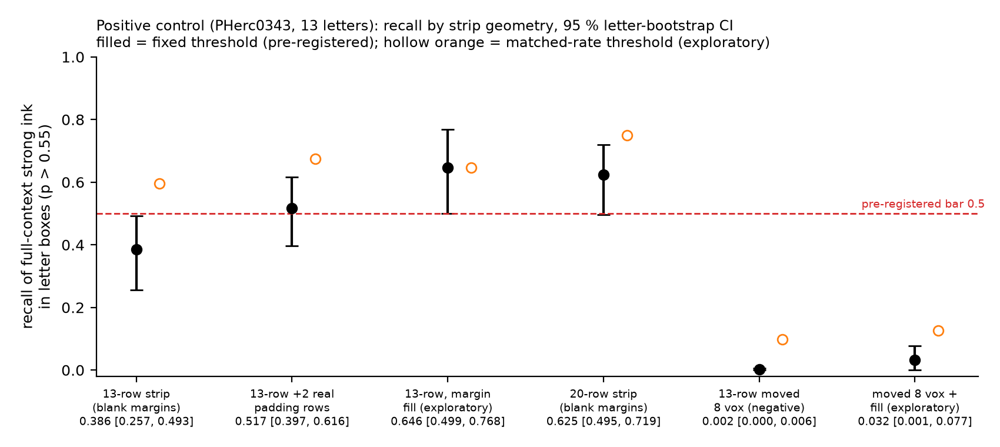
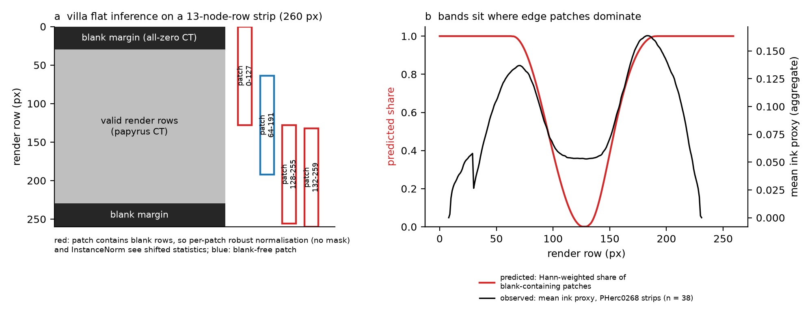
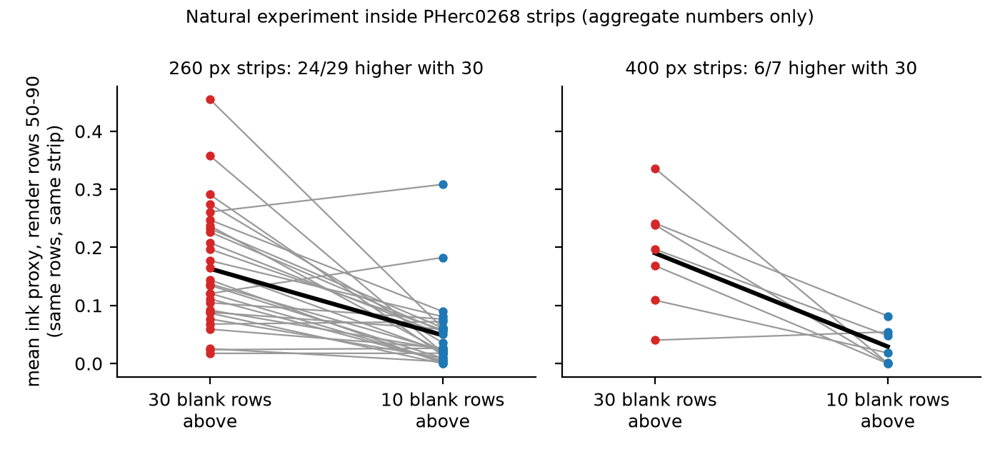
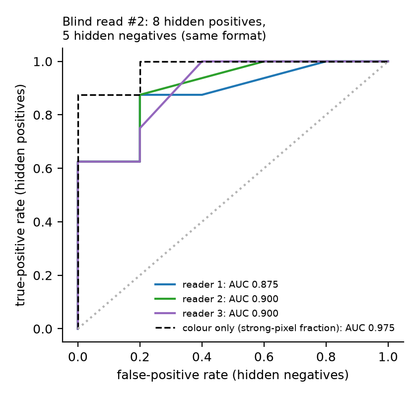

# Results

Every number in the tables is generated by [`scripts/write_tables.py`](../scripts/write_tables.py) from the committed JSON
named under each table. Each statement carries a label:
- **PRE-REGISTERED**: a decision rule in [prereg/DECL-FL-STRIP.md](prereg/DECL-FL-STRIP.md), committed before the
  first control result (by the project's private record, not independently verifiable; see the file's header);
- **EXPLORATORY**: an analysis added after seeing results;
- **MEASURED**, **INFERENCE**: as defined in [METHODS](METHODS.md).

Point estimates and interval bounds are rounded to the nearest value at the precision shown. The fold range is truncated toward zero.

## 1. The bug on a positive control (PHerc0343, 13 known letters)

**Setup.** We took Erwin Nieuwlaar's public First Letters segment of PHerc0343, where the letters are known (18 boxes; 13
of them, letters 6-18, fall inside the arms' node columns 34:166). We cut it the way mass ink runs cut fit meshes into strips,
rendered it, and inked it with three public models. Every arm is scored against the same surface inked in full context
(METHODS §2, §6). Depth d = +1.

Source: [`results/control_strips_rerun/results.json`](../results/control_strips_rerun/results.json), the rerun with
fresh inputs (§2). Its arms, in order:

<!-- BEGIN:control -->
| arm | strong ink in letter boxes | strong ink outside | enrichment E | recall [95 % CI] | r vs REF | box AUC | coverage |
|---|---|---|---|---|---|---|---|
| full context (reference), its valid px in node rows 42-107 (`REF`) | 15.81 % | 0.59 % | 26.6 | 1 (by definition) | 1.000 | 0.717 | 1.00 |
| 13-row strips, blank margins (`Z13`) | 7.46 % | 0.50 % | 14.8 | 0.386 [0.257, 0.493] | 0.785 | 0.670 | 0.86 |
| 13-row + 2 real padding rows (`P13`) | 10.31 % | 0.39 % | 26.3 | 0.517 [0.397, 0.616] | 0.858 | 0.698 | 1.00 |
| 13-row, margin reflect-filled (partial fix, exploratory) (`F13`) | 14.43 % | 1.35 % | 10.7 | 0.646 [0.499, 0.768] | 0.820 | 0.703 | 0.86 |
| 20-row strips, blank margins (`Z20`) | 10.41 % | 0.58 % | 17.9 | 0.625 [0.495, 0.719] | 0.892 | 0.694 | 0.92 |
| 13-row moved 8 vox outward (negative control) (`D8`) | 0.32 % | 0.29 % | 1.1 | 0.002 [0.000, 0.006] | 0.218 | 0.479 | 0.86 |
| same, with the fill (exploratory; conservative floor, RESULTS §1) (`FD8`) | 1.38 % | 0.39 % | 3.6 | 0.032 [0.001, 0.077] | 0.286 | 0.528 | 0.86 |
<!-- END:control -->

**Decisions.** Pre-registered rules, then the exploratory arms:

<!-- BEGIN:decisions -->
| pre-registered decision | original run | rerun |
|---|---|---|
| 13-row strips see ink (recall >= 0.5, E >= 5, r >= 0.6) | False | False |
| 20-row strips see ink | True | True |
| blank margins create an edge-band artifact on the control | False | False |
| 2 real padding rows fix it (recall >= 0.7, r >= 0.8, band rule not met) | False | False |
| negative ("no-ink") arm works (D8 in-box strong <= 0.2 x Z13) | True | True |
| depth, report only (no threshold): recall of `Z13` at d = -2 / at d = +1 | 1.109 (0.428 / 0.386) | not rerun |

| exploratory (not pre-registered) | rerun |
|---|---|
| margin fill: 13-row strips see ink (same rule) | True |
| margin fill meets the stricter 'fix' bar (recall >= 0.7, r >= 0.8; applied post hoc) | False (original run: False) |
| filled displaced copy (`FD8`): strong fraction, all scored px (conservative floor) | 0.76 % |
| extrapolated 2-row padding (`X13`, original run only, not rerun) meets the 'fix' bar | False (original run: recall 0.502, r 0.849, E 20.5) |
<!-- END:decisions -->

**Reading.**

**MEASURED:**
- Cut to the 13-row geometry that mass ink runs use, the same letters lose about half of their strong ink.
- The 13-row arm fails the pre-registered "sees ink" rule on recall, in the original run and in the reproduction.

**EXPLORATORY:**
- On the 13-row strips the ranking is mostly preserved (box AUC 0.670 vs 0.709 for the full-context map on the same
  pixels; 0.717 on all its pixels), but the p scale compresses: the 99th percentile of p falls from 0.690 (full
  context, same pixels) to 0.620, and at a threshold that flags as many pixels as the
  reference does (matched-rate recall) recall is 0.595 instead of 0.386. So a fixed display or threshold
  (p 0.40-0.70, p > 0.55) hides much of the ink that is still ranked correctly.
- Reflect-filling the blank margin, for the ink models only, restores the in-box strong fraction and the box AUC to
  nearly the full-context values.
- It recovers only part of the full-context strong pixels: recall stays below the stricter "fix" bar
  (recall ≥ 0.7, r ≥ 0.8; pre-registered for real padding, applied to the fill post hoc), in the original run and in
  the rerun. Its letter-bootstrap CI [0.499, 0.768] spans both the 0.7 "fix" bar and the 0.5 "sees ink" bar, so 13
  letters settle neither; the same holds for `Z20` [0.495, 0.719]. The CIs resample letters within one strip tiling
  and do not include strip-placement variability.
- The price is about twice the full-context rate of strong pixels outside the letter boxes overall (1.35 % vs 0.67 % at
  the same pixels), with the excess both near the edges and in the middle: in the 20-80 px edge band 0.97 % vs 0.59 % for full context at the same pixels (0.35 % without the
  fill), up to 3.56 % vs 1.25 % on strip r81-94, just under the pre-registered artifact rule (≥ 3×); in the strip
  middle 1.61 % vs 0.94 % without the fill (original run, `mid_f055_out`).
- **The displaced copy is not perfectly ink-free.** The models read layers S to S + 16, i.e. −6.5 to +9.5 vox around
  the surface at d = +1. A copy moved +8 vox outward therefore still holds the original sheet's CT peak (+2.5 vox) in
  the first layers of its window (METHODS §2). Without the fill (`D8`) that copy shows no letter-located signal; with
  the fill (`FD8`) it shows a weak one (in-box strong fraction above the outside fraction, recall a few percent;
  table). **INFERENCE:** the fill lets the models see the edge-of-window sheet that the blank margins suppress in `D8`.
  So `FD8` is a conservative floor, not a pure no-ink floor, and part of `D8`'s clean null may come from the same
  suppression. A copy displaced by a full sheet pitch, or a window that excludes the sheet, would be a cleaner
  negative; we did not run it.
- Two real padding rows help but do not reach the pre-registered "fix" bar, and neither does the fill. The fill
  recovers more in-box strong ink (recall 0.646 vs 0.517, overlapping CIs, no paired test) at lower specificity
  (E 10.7 vs 26.3; outside-box strong 1.35 % vs 0.39 %) and lower coverage (0.86 vs 1.00).
- A third exploratory arm, extrapolated 2-row padding (`X13`, `stripqc.geometry.xpad`), ran in the original run only:
  recall 0.502, r 0.849, E 20.5; it misses the "fix" bar too (decisions table). In one node column of one strip
  (r94-107, column 39) a hole next to the boundary row made that run's extrapolation step from the hole marker, so its
  2 padding nodes there fell far off the sheet; padding rows are not scored, and `xpad` was fixed after the run (X13 not
  rerun). Three fixes were tried; the fill is
  reported in front because it recovered the most in-box strong ink.

**Effective n and CIs.**
- Recall CIs resample the **letters** (13 clusters, 2 000 replicates), not pixels. Pixel counts run to hundreds of
  thousands, but neighbouring pixels are not independent.
- Each arm pools 5 strips (3 for `Z20`).
- One scroll, one segment, one depth, three models. Treat the size of the effect as specific to this setting. The
  direction of the strong fraction is consistent across strips: in the letter boxes it is lower than full context in
  all 5 `Z13` strips, and higher with the fill than without in all 5 (see `per_strip` in the JSON). The box AUC is
  lower than full context in only 3 of the 5 `Z13` strips.
- **Depth (pre-registered decision 6, report only, original run):** at d = −2, the depth of the PHerc0268 mass run,
  `Z13` recall is 0.428 (ratio 1.109 to d = +1) and its edge band is 0.37 % vs 0.75 % for full context: suppression,
  not false bands, at the mass-run depth too. Depth therefore does not explain the sign difference between scrolls.

## 2. Rerun with fresh inputs

A fresh shallow clone of an earlier `main` (commit `d466393` of the private working history) ran [`scripts/reproduce.sh`](../scripts/reproduce.sh), the procedure later
written up in [REPRODUCE.md](REPRODUCE.md), on the same 4-core machine about 3 h after the original run:
- fresh anonymous-S3 download of the CT chunks;
- fresh Hugging Face download of the weights, sha256-verified, with dense_native rebuilt;
- the segment repository's checksums checked (a local copy of commit `e8370f1`, not re-cloned);
- all 29 strips rendered, inked and scored.

The scripts were edited after this rerun (error exits and empty-input guards in reproduce.sh, run.sh, score_arms.py,
box_shift_check.py, batch_ink.sh and stripqc; absolute paths and space-safe job lines in run.sh and batch_ink.sh; the
overlay stage reads the model list from bi_common.py; a release-commit line; the default output directory, now
`$WORK/out` (the rerun wrote into `results/control_strips_rerun`); comments; and the band condition of decision 4); none
changes a value here (decision 4 stays False: P13 recall 0.517 < 0.7).

The software stack was the one documented in REPRODUCE §1 (not reinstalled; renderer not rebuilt). So this shows that
the result is deterministic with fresh inputs; it is not an independent reproduction. The comparison with the original run of
14 Oct 2026 ([`results/control_strips/original_results.json`](../results/control_strips/original_results.json)):

<!-- BEGIN:repro -->
| arm | metric | original run (14 Oct) | rerun (fresh clone, fresh CT and weights) | abs. difference |
|---|---|---|---|---|
| `REF` | f_in | 0.1581 | 0.1581 | 0.0000 |
| `REF` | f_out | 0.0059 | 0.0059 | 0.0000 |
| `Z13` | f_in | 0.0746 | 0.0746 | 0.0000 |
| `Z13` | f_out | 0.0050 | 0.0050 | 0.0000 |
| `Z13` | recall | 0.3860 | 0.3860 | 0.0000 |
| `Z13` | r | 0.7850 | 0.7849 | 0.0001 |
| `Z20` | f_in | 0.1041 | 0.1041 | 0.0000 |
| `Z20` | f_out | 0.0058 | 0.0058 | 0.0000 |
| `Z20` | recall | 0.6250 | 0.6247 | 0.0003 |
| `Z20` | r | 0.8920 | 0.8920 | 0.0000 |
| `P13` | f_in | 0.1031 | 0.1031 | 0.0000 |
| `P13` | f_out | 0.0039 | 0.0039 | 0.0000 |
| `P13` | recall | 0.5170 | 0.5168 | 0.0002 |
| `P13` | r | 0.8580 | 0.8583 | 0.0003 |
| `D8` | f_in | 0.0032 | 0.0032 | 0.0000 |
| `D8` | f_out | 0.0029 | 0.0029 | 0.0000 |
| `D8` | recall | 0.0020 | 0.0018 | 0.0002 |
| `D8` | r | 0.2180 | 0.2181 | 0.0001 |
| `F13` | f_in | 0.1443 | 0.1443 | 0.0000 |
| `F13` | f_out | 0.0135 | 0.0135 | 0.0000 |
| `F13` | recall | 0.6460 | 0.6455 | 0.0005 |
| `F13` | r | 0.8200 | 0.8196 | 0.0004 |
<!-- END:repro -->

<!-- BEGIN:repro_note -->
- **Match (MEASURED):** 22 of 22 compared values equal the original when rounded to the decimals the original stored (3-4); the largest absolute difference is 0.000468. All 5 thresholded pre-registered decisions are identical. Decision 6 (the depth ratio, report only) and the exploratory `X13` arm were run in the original only.
- **Limits of the match:** the original run kept its numbers rounded and not its maps, so the maps cannot be compared bit for bit. The sha256 of all 29 reproduced ensemble maps is in [`ens_sha256.txt`](../results/control_strips_rerun/ens_sha256.txt) for future comparisons.
- **Inputs:** 1.05 GB of CT fetched fresh from S3; the weights downloaded fresh and passed their sha256. The segment repository was a local copy of commit `e8370f1`, not a fresh clone; its checksums passed.
- **Runtime (MEASURED, 4 cores, 3 ink runs at a time):** 71.4 min for `reproduce.sh` in total: 0.6 min checksums and weights, 50.8 min for the 19 plain strips (including the CT download), 19.7 min for the 10 filled strips, 0.2 min scoring.
- **Box registration (MEASURED):** moving every letter box by ±20 px (one node) in x and y, 9 positions in all, changes no pre-registered or exploratory decision ([`box_shift_check.json`](../results/control_strips_rerun/box_shift_check.json)).
<!-- END:repro_note -->

## 3. The same artifact on real, unread data (PHerc0268: aggregate numbers only)

The bug was found on PHerc0268. A mass ink run over 56 strips cut from spiral fits showed orange bands, peaking about
30-50 px inside the valid top and bottom edges, in about 2/3 of the strips (pre-registration header;
[SUPERSEDED_CLAIMS](SUPERSEDED_CLAIMS.md) S10). They are not ink: they come from the blank margins (below).

**Natural experiment.**
- **Logic (INFERENCE):** inside the same strip, some column runs have a 30-row blank top margin and others a 10-row
  one, depending on whether the mesh's first node row is valid there. At the same render rows a physical feature
  should not depend on that, unless node-row-0 validity tracks local fit quality (the classes are different column
  runs). The fill test, not this comparison alone, separates the two.
- **Result (MEASURED):** the ink proxy is about 3-6× higher where the margin is 30 rows (36 of the 56 strips have both
  classes; in 6 of them it is not).
<!-- BEGIN:model_fit -->
- **Model fit (qualitative; MEASURED from the committed profile):** over the valid rows 30-229 of the 38 pooled 260 px strips, Pearson r = 0.61 between the ink proxy and the predicted blank share. The bands peak at rows 71 and 183, where the predicted share falls from 1 toward 0, and the trough at row 129 is where only blank-free patches contribute. The model does not predict the low proxy right at the valid edges (rows 30-35: 0.038), where the share is 1 (fig. 1b).
<!-- END:model_fit -->
- **INFERENCE:** the sign is opposite on the two scrolls. The zeros create ink on PHerc0268 and suppress it on
  PHerc0343, at d = +1 and at the mass-run depth d = −2 (§1). We have not isolated why. A private check found the
  robust-normalisation shift similar on both scrolls (not reproducible from this repository); InstanceNorm and the
  convolutions seeing zeros are untested hypotheses.

**Margin-fill test (MEASURED)**, 7 strips re-inked with the fill:
- the strong-ink fraction falls by a factor of 2.96 to 623.9;
- the bands disappear in 5 of 7 strips;
- no strip shows ink that is face-specific, absent on a displaced copy, and above the fill's floor. That floor
  (0.232-0.666 %, `fill_no_ink_floor_PHerc0343_displaced_frac_p055`) came from the 2 `FD8` strips available at the
  time; the rerun's five `FD8` strips give 0.219-2.364 % (`per_strip`, all scored pixels). A higher floor can only
  remove strips from the set that passes, and none passed.

Images and named per-strip records stay private (confidentiality, [README](../README.md#confidentiality)); the
natural-experiment JSON holds anonymised per-strip value pairs only.

<!-- BEGIN:pherc0268 -->
| PHerc0268 strips (aggregate only) | value |
|---|---|
| natural experiment, 260 px strips: ink proxy at rows 50-90, 30-row vs 10-row blank top margin | 0.163 vs 0.049; higher with 30 in 24/29 strips |
| natural experiment, 400 px strips: ink proxy at rows 50-90, 30-row vs 10-row blank top margin | 0.190 vs 0.029; higher with 30 in 6/7 strips |
| strong ink (p > 0.55) before -> after the margin fill, 7 strips | 3.67 %-14.27 % -> 0.02 %-2.93 % (2.96-623.9× lower) |
| edge-band / middle ink ratio before -> after the fill | 1.99-17.20 -> 0.61-2.38; below 1.3 in 5/7 |
<!-- END:pherc0268 -->

Sources: [`results/margin_artifact/natural_experiment_PHerc0268.json`](../results/margin_artifact/natural_experiment_PHerc0268.json),
[`results/margin_artifact/fill_test_PHerc0268_aggregate.json`](../results/margin_artifact/fill_test_PHerc0268_aggregate.json).

**Consequence (INFERENCE).** Any villa-based ink run on thin rendered strips is suspect if it keeps vc_render_tifxyz's
blank margins inside the inference patches. That covers fit-derived strips, ring patches and tile crops. Our own
first-pass PHerc0268 "ink" was mostly this artifact.

## 4. Blind reads with hidden controls

**Read #1 failed calibration (MEASURED).**
- Three blind readers did not recognise either hidden PHerc0343 positive: maximum confidence 0.35, and 1 of 6
  positive reads marked letter-like.
- There were no hidden negatives at all.
- One positive had been downscaled while the brief kept the full-scale glyph size.
- A read that cannot see its controls is uninformative, so nothing was concluded from it
  ([`results/blind_read/read1_uncalibrated_controls.json`](../results/blind_read/read1_uncalibrated_controls.json)).

**Read #2, with hidden controls (MEASURED).** It added hidden positives in the same strip format (control strips) and hidden
negatives in the same format (the `D8` strips, displaced +8 vox):

<!-- BEGIN:blind -->
| reader | AUC, 8 positives vs 5 negatives | positives flagged letter-like | negatives flagged |
|---|---|---|---|
| 1 | 0.875 | 5/8 | 0/5 |
| 2 | 0.900 | 3/8 | 0/5 |
| 3 | 0.900 | 4/8 | 0/5 |
<!-- END:blind -->

Caveats:
- The readers are AI agents (Claude sub-agents), not papyrologists.
- 13 control images give coarse ROC steps.
- **Colour baseline (MEASURED):** ranking the 13 control strips by the strong-pixel fraction of their rerun maps alone
  (the read used the original run's maps, not kept; the per-strip metrics the original stored, `per_strip_d1` in
  `original_results.json`, equal the rerun's `per_strip` at that precision; the whole-strip strong fraction used here was
  not stored by the original), with no reading,
  separates positives from negatives at AUC 0.975, better than any reader, and
  reader confidence follows that fraction (Spearman 0.878-0.918)
  ([`colour_baseline.json`](../results/blind_read/colour_baseline.json), from `scripts/blindread_colour_baseline.py`).
  This calibration therefore shows that readers respond to ink colour; it does not show letter recognition.
- The negatives were not colour-matched to the positives; use colour-matched negatives (LESSONS 17).

Reads of the unknown strips are not reported, whatever they showed, and nothing is concluded from them either way: this
calibration does not show letter recognition (colour baseline above).

## 5. What we do not claim

- No letters are claimed on any scroll.
- The ink-inference code behind the defect is unchanged on villa `main` at `5432721` (14 Oct 2026). The renderer has
  changed since `41701aa`, and we have not rechecked its blank margin there (METHODS §4).
- The fill was tested (exploratory) on one positive control (PHerc0343, d = +1, three 9 µm models). Other models, scales,
  overlaps or blend modes may behave differently. Run the control first ([REPRODUCE](REPRODUCE.md)).
- Suggested upstream change, **INFERENCE (untested):** villa could normalise each patch over its valid voxels only
  (`normalize_robust(..., mask=patch > 0, use_mask=True)`). InstanceNorm and the convolutions inside the network would
  still see the zeros. Filling the input is the only mitigation we have measured, and it is not a complete fix
  (§1: recall below the 0.7 bar, about twice the full-context strong pixels outside the letters).
